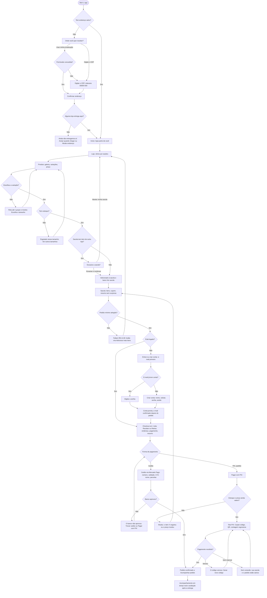
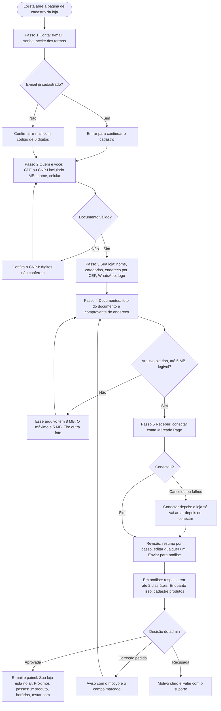
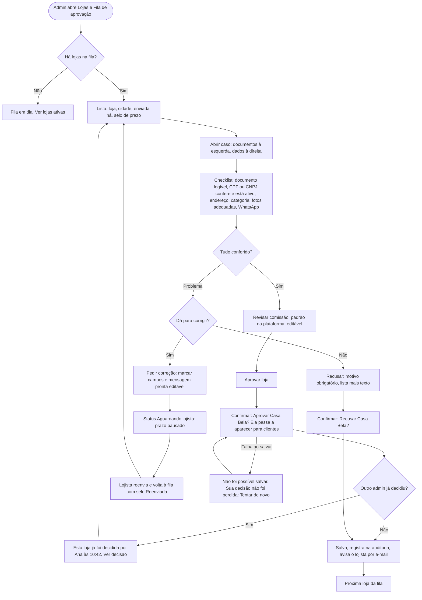
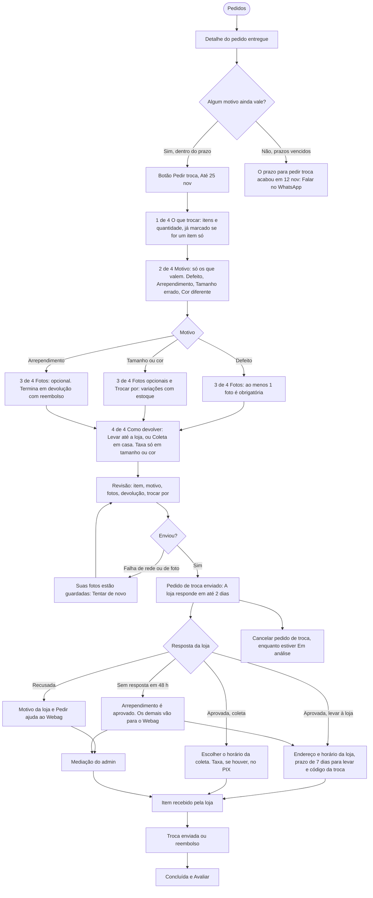

# Fluxos-chave e arquitetura de informação

> Autor: product-designer. Data: 2026-11-18. Base: brief §3 e §5; componentes e estados em `design-system.md`; textos em `identidade.md` §8. Itens marcados **[HIPÓTESE]** precisam de validação (lista na §7). Os diagramas usam Mermaid.

## 1. Convenções

- Retângulo = tela ou passo; losango = decisão; arredondado = início/fim.
- Todo fluxo tem **caminho de erro**. Falha de rede em qualquer passo cai no ErrorState padrão (`design-system.md` §5.3) com "Tentar de novo", mantendo o que o usuário digitou.
- "Toque" conta cada toque ou clique em botão, link, caixa ou item; digitar conta como **campo** (não como toque: o teclado avança com "Próximo").
- Telas detalhadas: `docs/design/telas/` (onda 2: lojista e admin; onda 3: descoberta; onda 4: transação).
- Eventos de analytics na §8 (para combinar com o PO).

## 2. Orçamento: compra em menos de 2 minutos

Definição: do toque no ícone do app até o **pagamento PIX confirmado**, para morador que nunca usou, em Android de entrada com 4G. **Tempos são [HIPÓTESE]** de modelo simples (toque ≈ 1,2 s com leitura; campo de texto 3 a 8 s com preenchimento automático); o teste cronometrado do brief §7 fecha os números.

| # | Passo (novo usuário) | Toques | Campos | Segundos |
|---|---|---|---|---|
| 1 | Abrir, "Usar minha localização", permissão do sistema | 2 | 0 | 8 |
| 2 | Início: tocar numa loja | 1 | 0 | 5 |
| 3 | Loja: tocar num produto | 1 | 0 | 6 |
| 4 | Produto: tamanho, cor, "Adicionar" | 3 | 0 | 9 |
| 5 | "Ver sacola", conferir, "Ir para o pagamento" | 2 | 0 | 8 |
| 6 | Criar conta: nome, celular, e-mail, senha, aceite, "Criar conta" | 2 | 4 | 35 |
| 7 | Checkout (1 tela): confirmar número do endereço, "Pagar com PIX" | 1 | 1 | 12 |
| 8 | PIX: "Copiar código" | 1 | 0 | 3 |
| | **Subtotal no Webag** | **13** | **5** | **86 s** |
| 9 | Pagar no app do banco (fora do Webag) [HIPÓTESE] | n/a | n/a | 25 s |
| | **Total até confirmar** | | | **≈ 111 s (meta < 120 s)** |

**Variante B (se a confirmação de e-mail por código bloquear a compra):** +1 a 2 toques e ≈ +45 s (sair para o app de e-mail, ler, voltar, colar) = **≈ 156 s, estoura a meta**. Por isso o desenho padrão é **A: confirmar o e-mail depois do pedido, sem bloquear** (HIP-D07). Exige parecer do Security (risco: conta criada com e-mail não confirmado; mitigação: PIX gera pedido já pago, e confirmação obrigatória para trocar senha, trocar e-mail, exportar dados e excluir conta).

**Usuário que volta (logado, endereço salvo):** 9 a 10 toques, 0 campos, **≈ 42 s no Webag + 25 s do banco = ≈ 67 s**.

**Folga é pequena (≈ 9 s) no caso novo.** Alavancas, em ordem de ganho, se o teste estourar:
1. **Entrar com Google** no lançamento (substitui o passo 6: 2 toques, ≈ 6 s, economia ≈ 29 s). Quase todo Android tem conta Google. No iOS, Apple é obrigatória se houver Google (App Store). O brief pede "preparado para"; recomendo **ligar no lançamento**. Depende de contas do fundador.
2. Autopreenchimento do Android/iOS para nome, celular e e-mail.
3. Remover "confirmar senha" (já aplicado, HIP-D06) e usar olho para mostrar a senha.
4. Cadastro pede CPF só se o Mercado Pago exigir, e só no checkout.

**Metas de usabilidade dos 4 fluxos** (medir no teste do brief §7):

| Tarefa | Telas | Toques | Campos | Palavras na tela de decisão | Tempo |
|---|---|---|---|---|---|
| Comprar (novo) | 7 | ≤ 13 | ≤ 5 | ≤ 25 | ≤ 86 s no app |
| Comprar (recorrente) | 6 | ≤ 10 | 0 | ≤ 25 | ≤ 45 s |
| Cadastrar loja (lojista) | 5 passos + revisão | ≤ 20 | ≤ 14 | ≤ 40 por passo | ≤ 10 min [HIPÓTESE] |
| Aprovar loja (admin) | 1 caso | ≤ 10 | 0 a 1 | n/a | ≤ 90 s por loja |
| Pedir troca | 5 | ≤ 11 | 0 a 1 (texto livre opcional) | ≤ 25 | ≤ 90 s |

## 3. Fluxo 1: Comprar (cliente, app)

Decisões: explorar sem conta; cadastro só no checkout (brief §3.1); **e-mail primeiro** na tela de entrar (se já tem conta pede só a senha; senão abre o cadastro); checkout em **1 tela** (Receber ou retirar + endereço + pagamento + resumo), total de 3 passos reais (Sacola, Checkout, PIX); PIX é o método pré-selecionado; frete e taxas já aparecem na Sacola.



**Pontos de projeto**
- Loja fechada: vitrine navegável, botão "Adicionar" vira "Fechada · abre 9h" (sem compra). **[HIPÓTESE]** agendamento fica para a fase 2.
- Retirada: o endereço do checkout vira endereço e horário da loja, sem taxa de entrega; mostra "Pronto em ≈ 30 min" (valor da loja). Na confirmação aparece o **código de 4 dígitos** para dizer à loja (HIP-040), em `numeral`.
- PIX vence em 15 min (HIP-006, configurável); a contagem regressiva usa esse valor. Loja tem 10 min para aceitar (HIP-008): a linha do tempo mostra "Aguardando a loja aceitar" e, se cancelar por falta de resposta, explica o estorno total.
- Pedido recusado ou item cancelado pela loja: aviso por push e na tela do pedido, com o reembolso explicado (`identidade.md` §8).
- Pagamento PIX: tela mantém a tela acesa, escuta confirmação por WebSocket, e se o app for para segundo plano e voltar já mostra o estado atual.
- Acessibilidade e estados: ver `design-system.md` §5 e §7.

## 4. Fluxo 2: Cadastrar loja (lojista, painel web responsivo)

Decisões: **5 passos com rascunho automático** (pode sair e voltar pelo e-mail); um assunto por passo; documentos fotografados pelo celular; recebimento via OAuth do Mercado Pago (split, brief §4); enquanto a loja está em análise o lojista **já pode cadastrar produtos** (reduz o tempo morto); a loja só fica visível ao cliente com aprovação + conta de recebimento ativa + 1 produto ativo (HIP-030). Código de e-mail: 6 dígitos, 10 min (HIP-022).



**Pontos de projeto**
- Passo 1 e 2 juntos têm 6 campos; total ≤ 14 campos em 5 passos. Barra "Passo 3 de 5", botões Voltar e Continuar fixos no rodapé (ao alcance do polegar no celular).
- CNPJ: consulta e preenche razão social e endereço **[HIPÓTESE]** (depende de fonte de dados; backend avalia). MEI: aceita CPF do titular.
- Documento: botão "Tirar foto" abre a câmera; detecta imagem escura ou tremida **[HIPÓTESE, só aviso simples]**.
- Pós-aprovação: lista de 3 tarefas ("Cadastrar o primeiro produto", "Definir horário", "Testar o som dos pedidos") com progresso; sem tutorial em vídeo.
- Estados: salvando ("Salvo às 14:32"), erro de upload por arquivo, sem conexão (rascunho local), sessão expirada (volta ao mesmo passo).

## 5. Fluxo 3: Aprovar loja (admin)

Decisões: fila ordenada pela mais antiga, com selo de SLA; documento **ao lado** do formulário (sem trocar de aba); checklist obrigatório antes de aprovar; **recusa e pedido de correção exigem motivo**; toda decisão gera auditoria e notificação; conflito entre dois admins avisa em vez de sobrescrever.



**Pontos de projeto**
- Perfis com permissão de aprovar: super admin e operação. Suporte e financeiro só leem.
- Ações do caso (de cima para baixo no painel direito): checklist, comissão, **Aprovar loja** (primário), **Pedir correção** (secundário), **Recusar** (texto destrutivo). Atalho `a` aprova, só depois do checklist.
- Prazo de resposta (2 dias úteis) é **configurável** em Configurações **[HIPÓTESE]**.
- Meta: ≤ 90 s por loja quando os documentos estão legíveis.

## 6. Fluxo 4: Pedir troca (cliente, app) — Retira Troca

Alinhado às regras do PO em `docs/decisoes.md` HIP-017 a HIP-020 (arrependimento 7 dias e defeito 30 dias são piso legal e a política da loja não os desliga; tamanho e cor dependem da loja; loja responde em 48 h; sem resposta, arrependimento é aprovado e os demais vão à mediação; cliente tem 7 dias para entregar o item).

Decisões de design: entrada **a partir do pedido entregue** (contexto já conhecido, nada a redigitar, WCAG 3.3.7); o botão mostra o prazo ("Até 25 nov"); 4 passos curtos com progresso; **a lista de motivos já mostra só o que vale**: Arrependimento (até 7 dias) e Defeito (até 30 dias) sempre aparecem dentro do prazo; Tamanho errado e Cor diferente aparecem se a loja aceita, com a explicação "Essa loja não faz troca por tamanho ou cor" quando não; **foto obrigatória só para defeito**; Arrependimento termina em **devolução com reembolso** (sem passo "trocar por").



**Linha do tempo da troca (StatusTimeline, 7 passos):** Enviada, Em análise, Aprovada (ou Recusada), Devolução (levar ou coleta), Recebida pela loja, Nova entrega ou reembolso, Concluída. Contato da loja por WhatsApp sempre visível.

**Pontos de projeto**
- **Trocar por:** quando o motivo é tamanho ou cor, mostra as variações **com estoque** da loja; se nenhuma tem estoque, oferece "Escolher depois com a loja" ou reembolso (a loja decide).
- **Base legal [validar com jurídico, como já sinalizado em HIP-017]:** o CDC (art. 49) dá 7 dias para desistir de compra feita fora do estabelecimento, inclusive por app. Por isso o motivo Arrependimento aparece mesmo quando a loja "não faz troca" e leva a reembolso. O brief (§3.1) diz que a loja define se aceita; o design respeita isso só para tamanho e cor.
- **Divergência com HIP-018 (PO):** a hipótese cobra a taxa de coleta "ao solicitar". Recomendo cobrar **depois que a loja aprovar** a coleta: assim o pedido de troca não tem passo de pagamento (menos fricção), e uma recusa não obriga estorno de taxa. Decisão do PO.
- Prazos de resposta (48 h) e de levar o item (7 dias) são configuráveis (HIP-019).
- Estados: salvando rascunho do pedido de troca, upload por foto com progresso, sem conexão, permissão de câmera negada (`design-system.md` §5.6).

## 7. Arquitetura de informação

### 7.1 App do cliente

```
Webag (app)
├─ Início [aba]
│   ├─ Endereço (folha) > Meus endereços > Novo endereço (localização ou CEP)
│   ├─ Busca > Resultados (Produtos | Lojas) > Filtros (folha)
│   ├─ Categoria > lojas e produtos
│   ├─ Loja > Produto > Avaliações
│   ├─ Banner (destino definido no admin)
│   └─ Sacola (ícone e barra) > Checkout > PIX ou Cartão > Pedido confirmado
├─ Buscar [aba]   histórico, categorias, resultados
├─ Pedidos [aba]
│   ├─ Em andamento > Acompanhar (linha do tempo, WhatsApp da loja)
│   └─ Anteriores > Detalhe > Pedir de novo | Pedir troca > Acompanhar troca | Avaliar
└─ Conta [aba]
    ├─ Entrar ou criar conta (visitante)
    ├─ Dados pessoais > Alterar senha
    ├─ Endereços | Favoritos (lojas e produtos) | Cupons
    ├─ Trocas (Retira Troca)
    ├─ Notificações (preferências)
    ├─ Ajuda (perguntas frequentes, falar com o Webag)
    ├─ Privacidade: Exportar meus dados | Excluir conta
    └─ Termos e Privacidade | Sair
```

| Regra de navegação | |
|---|---|
| Barra inferior | 4 abas (Início, Buscar, Pedidos, Conta), visível nas telas de 1º nível; **escondida** em Produto, Sacola, Checkout e PIX (foco na ação) |
| Sacola | Ícone no header da Início e Loja + barra flutuante "Ver sacola · 2 itens · R$ 89,90" após adicionar |
| Visitante | Vê tudo. Pede conta ao: pagar, favoritar, ver pedidos. Sacola do visitante é local e migra ao entrar |
| Deep links | Push "Saiu para entrega" > Acompanhar; push de troca > status da troca; link de loja compartilhado > Loja; link de cupom > Sacola |
| Voltar | Sempre volta ao ponto de onde veio, com rolagem e filtros preservados |
| Conta excluída | Fluxo na Conta (obrigatório na Apple e LGPD): confirma, pede senha, explica o que será apagado e o que a lei obriga guardar |

### 7.2 Painel do lojista (web responsivo)

```
Celular (barra inferior): Pedidos | Produtos | Início | Mais        Desktop (barra lateral): tudo abaixo
Início         vendas do dia e da semana, ticket médio, mais vendidos, avaliação média; pendências (pedidos novos, trocas)
Pedidos        Novos | Em preparo | Prontos ou Saiu | Concluídos | Todos; detalhe; imprimir comanda; histórico
Trocas         Fila | Em andamento | Concluídas; aprovar ou recusar; acompanhar coleta
Produtos       lista | seções da vitrine | importar planilha | ações em massa (pausar, mudar preço)
               produto: fotos (recorte), variações e estoque, preço e promoção com período
Cupons         próprios da loja
Avaliações     responder
Financeiro     resumo | repasses | extrato (exportar)
Minha loja     perfil (logo, capa, descrição, categorias) | horários e pausa | entrega e retirada (raio, taxa, mínimo, grátis acima de X)
               trocas (aceita, prazo, taxa de coleta) | WhatsApp | recebimento (Mercado Pago)
Equipe         dono e funcionários com permissões
Ajuda          alertas sonoros (teste), contato Webag
```
Pausar produto e pausar loja ficam a **1 toque** na lista (alternador com rótulo "Vendendo / Pausado"), não escondidos em edição.

### 7.3 Painel admin (web)

```
Visão geral    KPIs e pendências (lojas na fila, trocas em disputa)
Lojas          Fila de aprovação | Todas | detalhe (dados, documentos, comissão, suspender, editar qualquer dado)
Pedidos        Pedidos | Trocas e disputas (cancelar, estornar, mediar)
Usuários       Clientes | Lojistas | Admins e perfis (bloquear, redefinir senha)
Catálogo       Categorias e subcategorias (ícone da lista, ordem) | Moderação de produtos
Financeiro     Comissões (padrão, categoria, loja) | Taxa de serviço | Repasses | Conciliação | Relatórios
Marketing      Banners | Destaques | Cupons da plataforma | Push segmentado | Termos e Privacidade
Regiões        Cidades e bairros (liberar ou fechar)
Relatórios     Pedidos, GMV, novas lojas, novos clientes, recompra, cancelamentos
Configurações  Parâmetros do negócio | Feature flags | Modo manutenção
Auditoria      Log de todas as ações
```

| Perfil | Vê |
|---|---|
| Super admin | Tudo, incl. Usuários > Admins, Configurações |
| Operação | Visão geral, Lojas, Pedidos, Catálogo, Marketing, Regiões, Relatórios |
| Financeiro | Visão geral, Pedidos (leitura), Financeiro, Relatórios |
| Suporte | Pedidos e trocas, Usuários (leitura e redefinição de senha), Lojas (leitura) |

Item sem permissão não aparece no menu; link direto mostra "Você não tem acesso a essa área".

## 8. Eventos de analytics (a combinar com o PO; sem dados pessoais)

| Fluxo | Eventos (propriedades) |
|---|---|
| Comprar | `address_set` (método: gps ou cep), `store_viewed`, `product_viewed`, `variant_selected`, `add_to_cart`, `cart_store_switched`, `cart_viewed`, `checkout_started`, `signup_started`, `signup_completed` (método), `payment_method_selected`, `pix_generated`, `pix_copied`, `pix_expired`, `payment_confirmed`, `order_placed`. Todos com `ms_since_app_open` para medir o "< 2 min" |
| Cadastrar loja | `merchant_step_viewed` (passo), `merchant_step_completed`, `merchant_upload_failed`, `merchant_submitted`, `merchant_connected_mp` |
| Aprovar loja | `admin_case_opened`, `admin_store_approved`, `admin_correction_requested`, `admin_store_rejected` (com tempo de decisão) |
| Trocar | `exchange_started`, `exchange_reason_selected`, `exchange_submitted`, `exchange_approved`, `exchange_rejected`, `exchange_escalated` |
| Erros e estados | `empty_state_viewed` (tela), `error_state_viewed` (tipo), `offline_banner_shown` |

Consentimento e base legal da coleta: **Security e PO** definem (LGPD).

## 9. Dúvidas e pendências

| # | Para | Pergunta ou pendência |
|---|---|---|
| 1 | PO | "Confirmação" no cadastro (brief §3.1) significa confirmar senha? Proponho remover o campo (HIP-D06) |
| 2 | Security | Aceitar confirmação de e-mail **depois** do pedido (HIP-D07)? Sem isso a meta de 2 minutos não fecha para quem nunca usou |
| 3 | PO + jurídico | Validar HIP-017 (arrependimento 7 dias e defeito 30 dias como piso legal) e a cobrança da taxa de coleta só após a aprovação da loja, em vez de "ao solicitar" (HIP-018), §6 |
| 4 | Backend | O Mercado Pago exige CPF para PIX e cartão? Se sim, entra 1 campo no checkout (HIP-D10) |
| 5 | PO | Habilitar login com Google no lançamento (maior ganho de tempo na 1ª compra) |
| 6 | PO | Os textos de prazo da interface ("responde em até 2 dias", "reembolso em até 2 dias úteis") devem ser lidos das hipóteses configuráveis (HIP-019, HIP-030, HIP-020), não fixados no código |
| 7 | PO | UI usa "Sacola" em vez de "Carrinho" (HIP-D05) |
| 8 | PO | Mapa na escolha de endereço fica fora da 1.0 (custo e dados de terceiros); CEP + localização bastam? |
