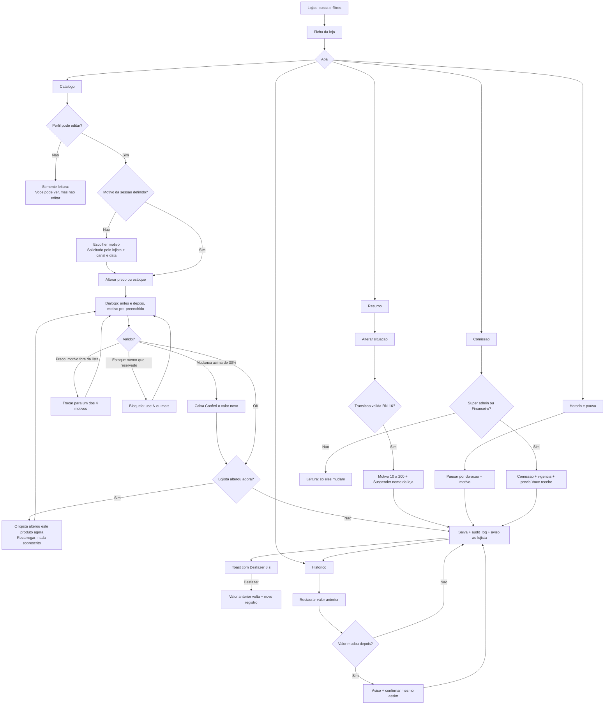
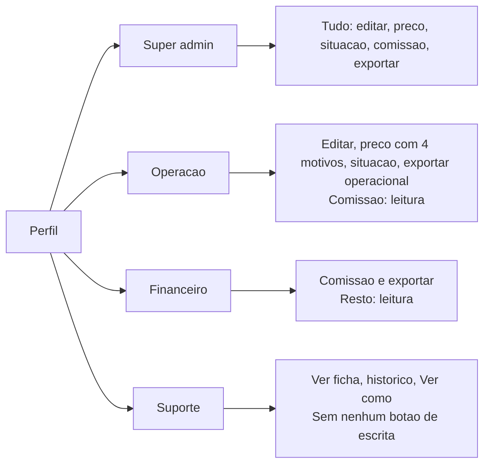

# Fluxos v1.1: admin, gestão das lojas

> Autor: product-designer. Data: 2026-11-22. Spec: `telas/v1-1-admin-lojas.md`.

## 1. Da lista à edição (com motivo, aviso e auditoria)

## 2. "Ver como o lojista" (somente leitura)

```mermaid
flowchart TD
  F[Ficha] --> BT[Ver como o lojista] --> PR{Perfil}
  PR -->|Qualquer um dos 4| MO[Dialogo: motivo obrigatorio]
  MO -->|Cancelar| F
  MO -->|Abrir visualizacao| LG[audit_log: quem, loja, quando, motivo]
  LG --> VW[Telas do lojista com faixa fixa<br/>Visualizacao do admin - Somente leitura]
  VW --> PD[Pedidos: dado do cliente como o lojista ve RN-14]
  VW --> AC[Acoes de escrita: etiqueta so o lojista, sem botao]
  VW -->|Requisicao direta de escrita| E403[Servidor recusa 403]
  VW -->|Sessao do admin expira| EX[Visao fecha, vai ao login]
  VW -->|Sair da visualizacao| F
  VW -->|30 min| REN[Pede novo motivo - proposta, Security decide]
```

## 3. Permissões na tela (o que aparece)

