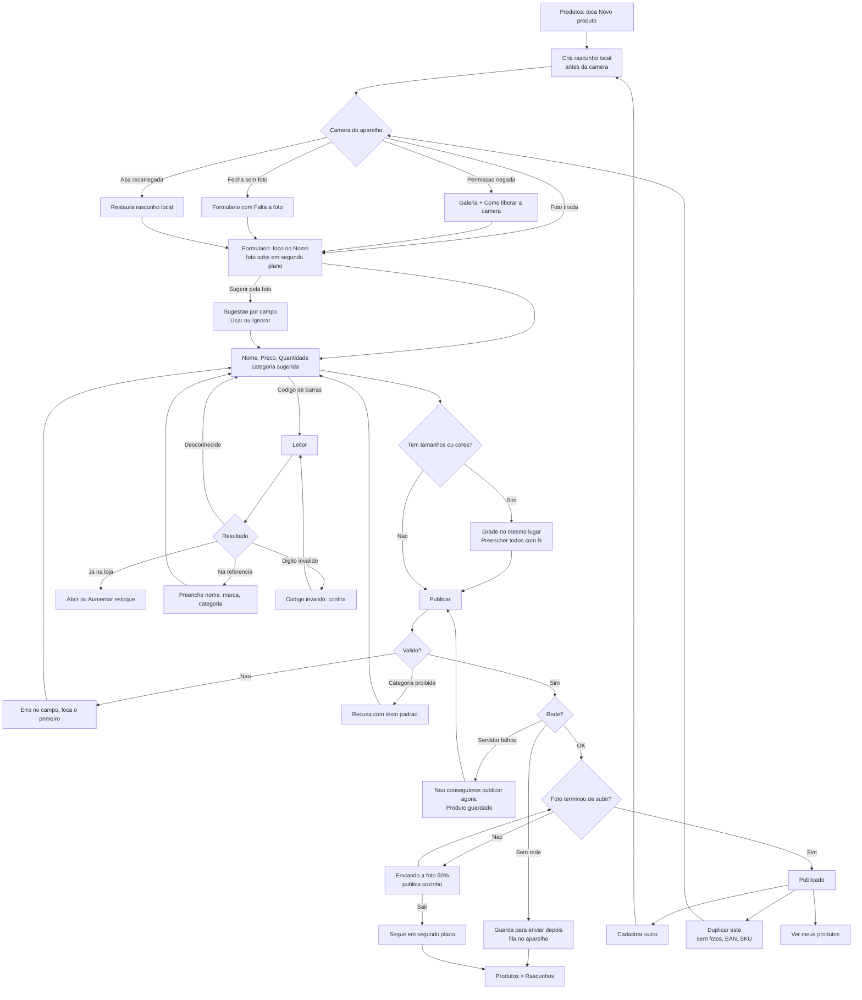
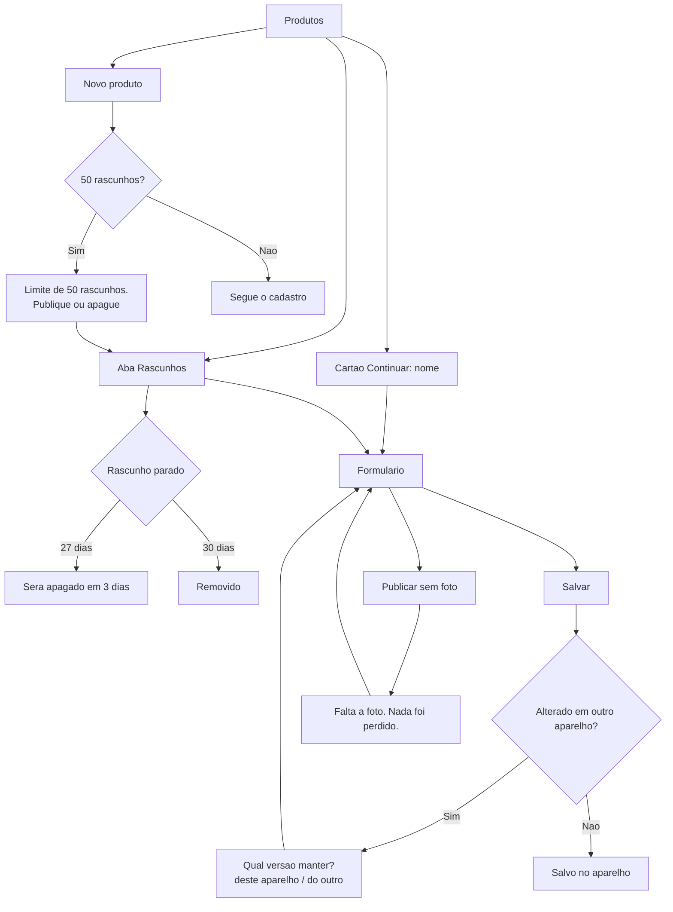
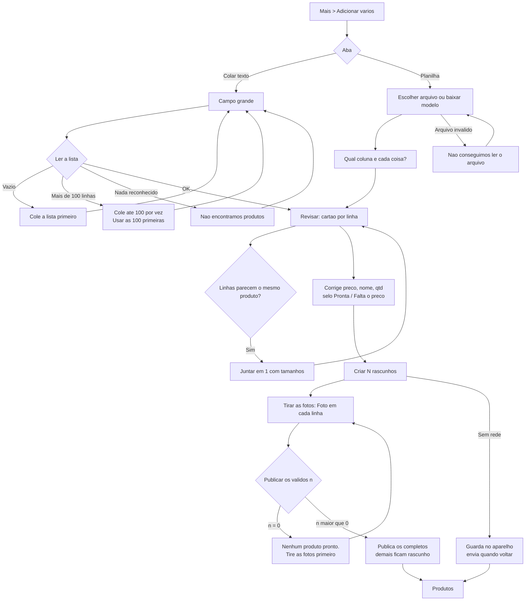
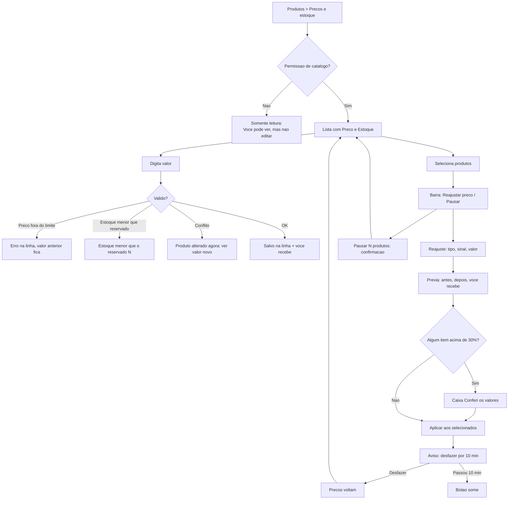

# Fluxos v1.1: cadastro rápido, colar lista e edição em massa

> Autor: product-designer. Data: 2026-11-22. Specs: `telas/v1-1-cadastro-rapido.md`, `telas/v1-1-importar-colar.md`, `telas/v1-1-edicao-em-massa.md`.

## 1. Cadastro rápido de 1 produto (caminho feliz e erros)

## 2. Rascunho: retomar, limite, expirar, conflito

## 3. Colar lista do WhatsApp (e planilha)

## 4. Edição em massa

