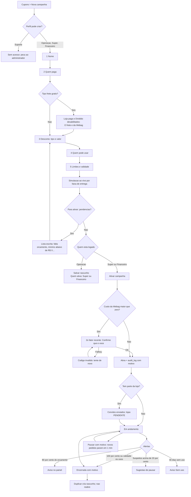
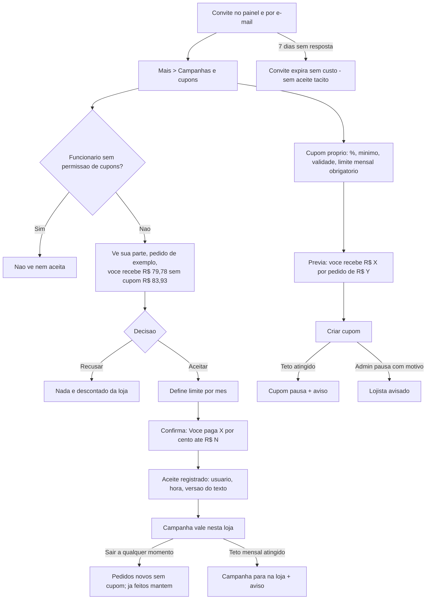
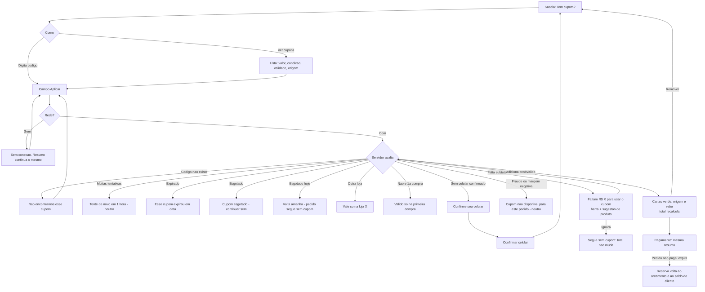
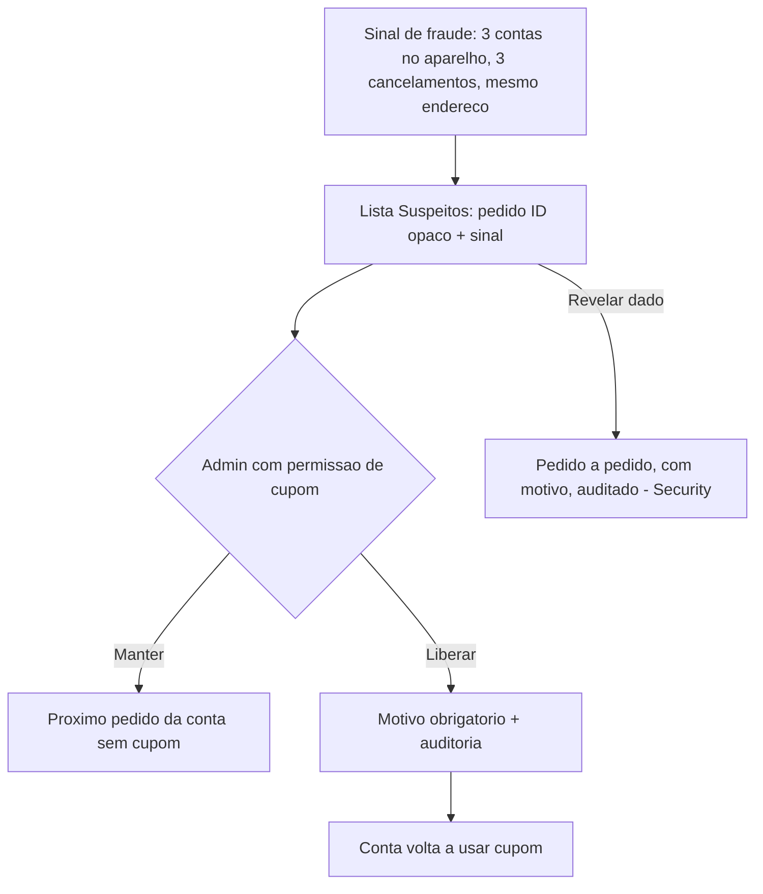

# Fluxos v1.1: cupons e campanhas (admin, lojista, cliente)

> Autor: product-designer. Data: 2026-11-22. Specs: `telas/v1-1-admin-cupons.md`, `telas/v1-1-cupom-cliente.md`.

## 1. Admin: criar e ativar campanha

## 2. Lojista: convite de campanha

## 3. Cliente: aplicar cupom (sacola e checkout)

## 4. Suspeitos (admin)

