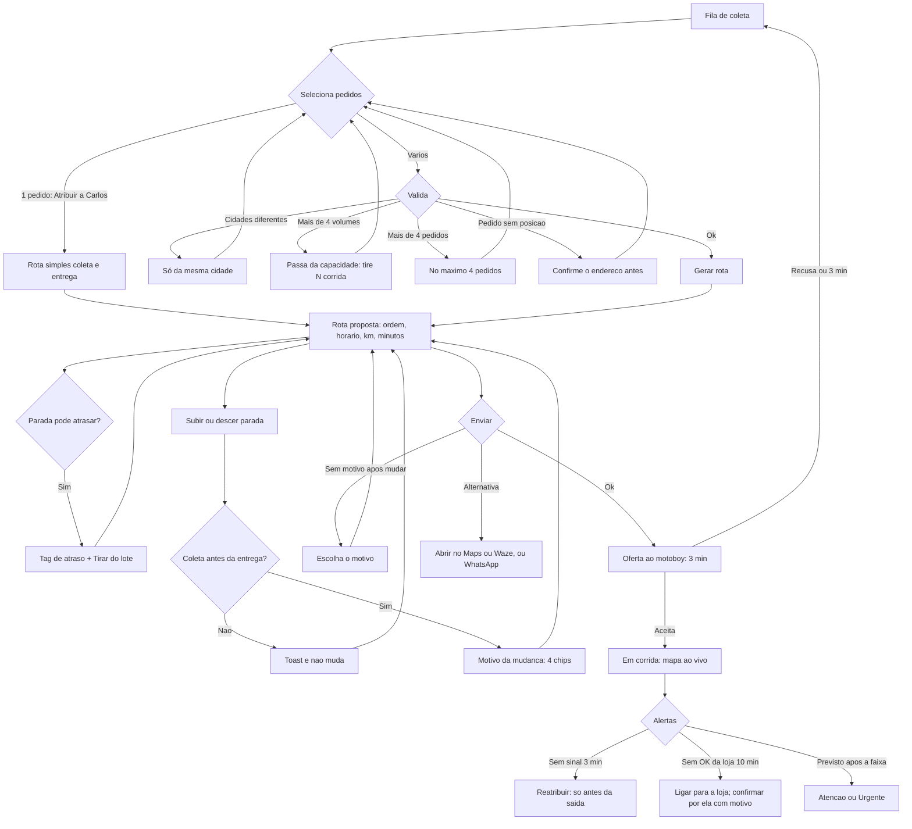
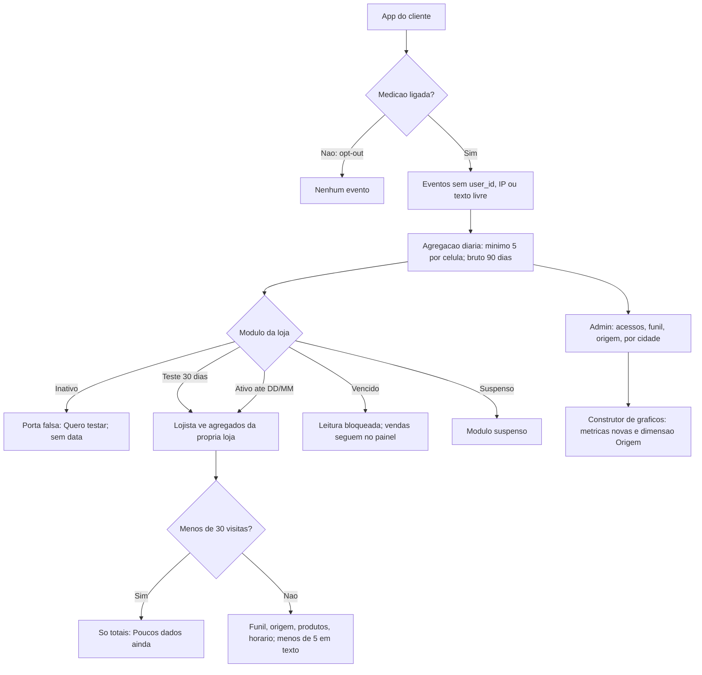
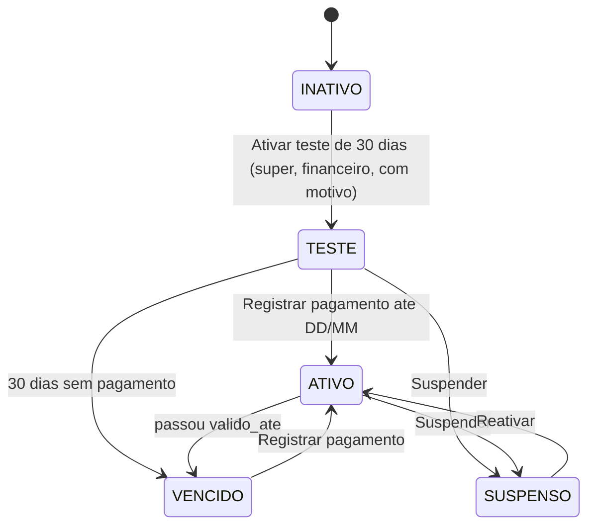

# Fluxos v1.1: despacho e rota (R3) e análises (R5)

> Autor: product-designer. Data: 2026-11-22. Specs: `telas/v1-1-admin-despacho.md`, `v1-1-analises-admin.md`, `v1-1-analises-lojista.md`.

## 1. Despacho: fila, lote, rota, envio

## 2. Análises: coleta, agregação e o que cada um vê

## 3. Módulo por loja (admin)

