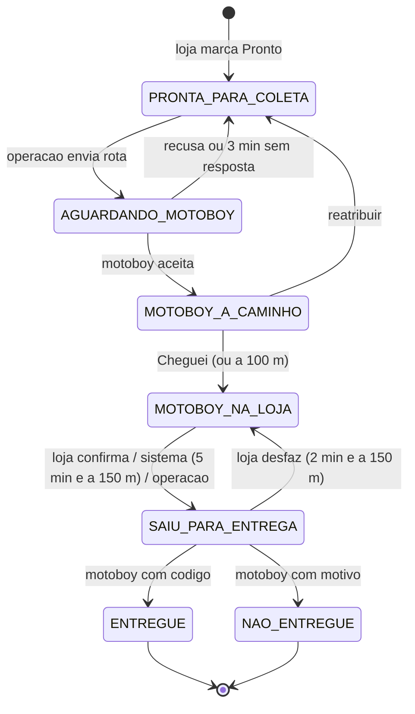
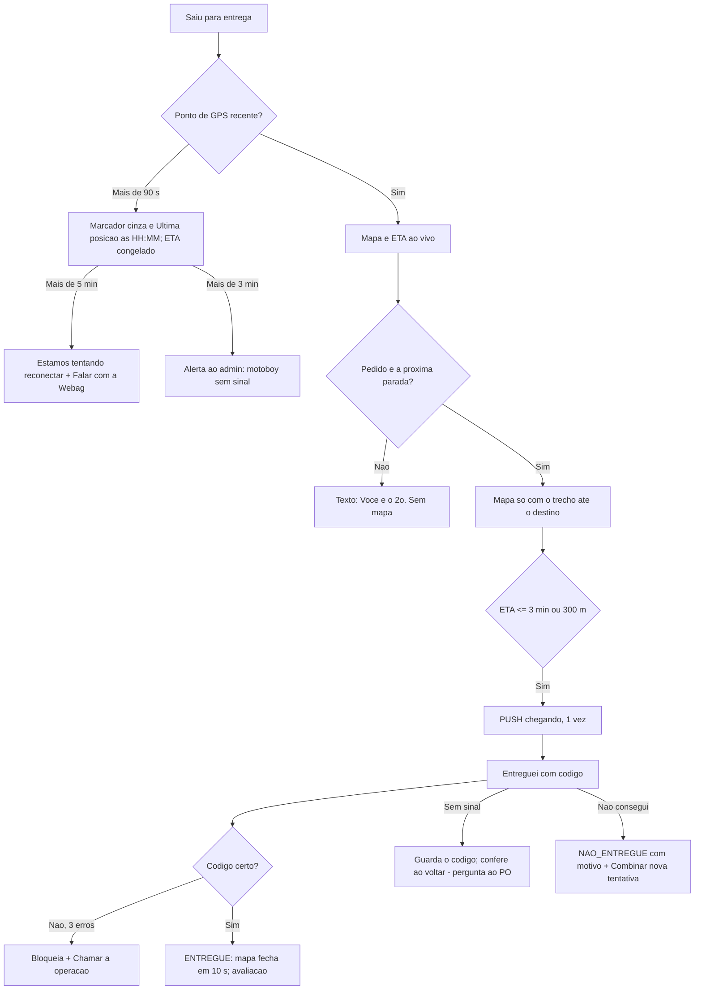

# Fluxos v1.1: estados do pedido e da entrega (R3 e R4)

> Autor: product-designer. Data: 2026-11-22. Specs: `telas/v1-1-notificacoes.md`, `v1-1-loja-confirma-saida.md`, `v1-1-rastreio-cliente.md`. Regra é do PRD `v1-1-rastreio-e-notificacoes.md` (tabela de estados); aqui só o desenho do que cada papel vê.

## 1. Estados da entrega e quem muda



## 2. O que cada papel vê, por etapa (sequência do caminho feliz)

```mermaid
sequenceDiagram
  participant C as Cliente
  participant L as Lojista
  participant M as Motoboy
  participant A as Admin
  L->>A: Pronto para coleta (fila; alerta 10 e 20 min)
  A->>M: Rota enviada (push com som, 3 min)
  M->>A: Aceita (GPS liga)
  A-->>C: in-app a caminho da loja (sem push)
  M->>L: Cheguei (faixa com som)
  M->>L: Peguei o pedido
  alt Loja confirma
    L->>C: PUSH Saiu para entrega (abre o mapa)
  else 3 min: lembrete forte
    L->>C: PUSH Saiu para entrega
  else 5 min e a 150 m: automatica
    A-->>L: aviso e e-mail de resumo; contestar em 10 min
    A->>C: PUSH Saiu para entrega
  else 10 min sem OK
    A->>A: alerta com som: ligue para a loja
  end
  M-->>C: posicao (so se o pedido e a proxima parada)
  A->>C: PUSH O motoboy esta chegando (3 min ou 300 m)
  M->>C: Entreguei com codigo -> PUSH Entregue; mapa fecha
```

## 3. Caminhos de erro e divergências



## 4. Quem vê o quê (resumo)

| Estado | Cliente | Lojista | Motoboy | Admin |
|---|---|---|---|---|
| Pronto | "Pronto, aguardando o motoboy" | "Pronto para coleta" | n/a | fila |
| Oferta | n/a | n/a | oferta com contagem | "Aguardando aceite" |
| Na loja | "O motoboy chegou à loja" | faixa com som | "Aguardando a loja" | n/a |
| Saiu | mapa ou "Você é o 2º" | "Saída registrada" | próxima parada | histórico com fonte |
| Entregue | "Entregue às HH:MM" | "Entregue" | próxima parada | histórico |
