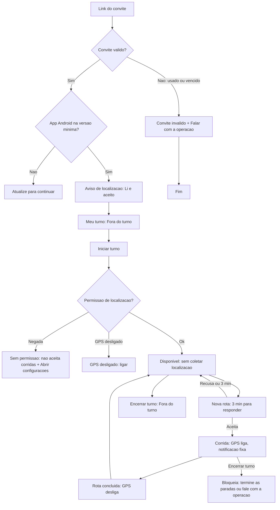
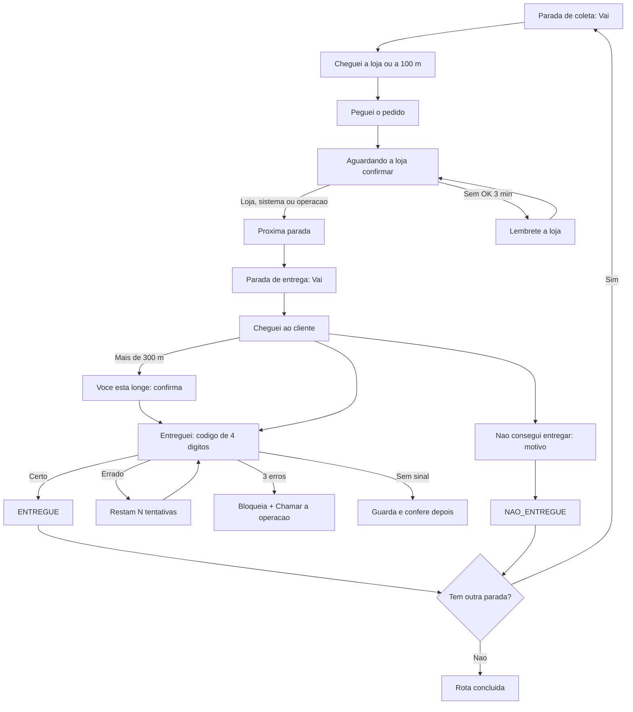
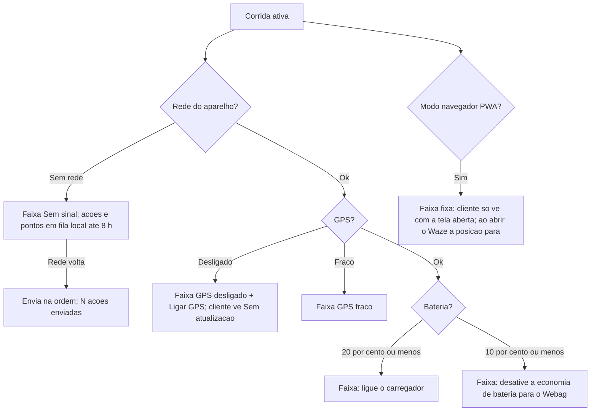

# Fluxos v1.1: turno e etapas do motoboy (R4)

> Autor: product-designer. Data: 2026-11-22. Spec: `telas/v1-1-app-motoboy.md`. Regras: RN-D5 a RN-D8 do PRD de despacho.

## 1. Entrada, permissão e turno

## 2. Etapas de uma parada

## 3. Sinal, GPS e bateria durante a corrida

