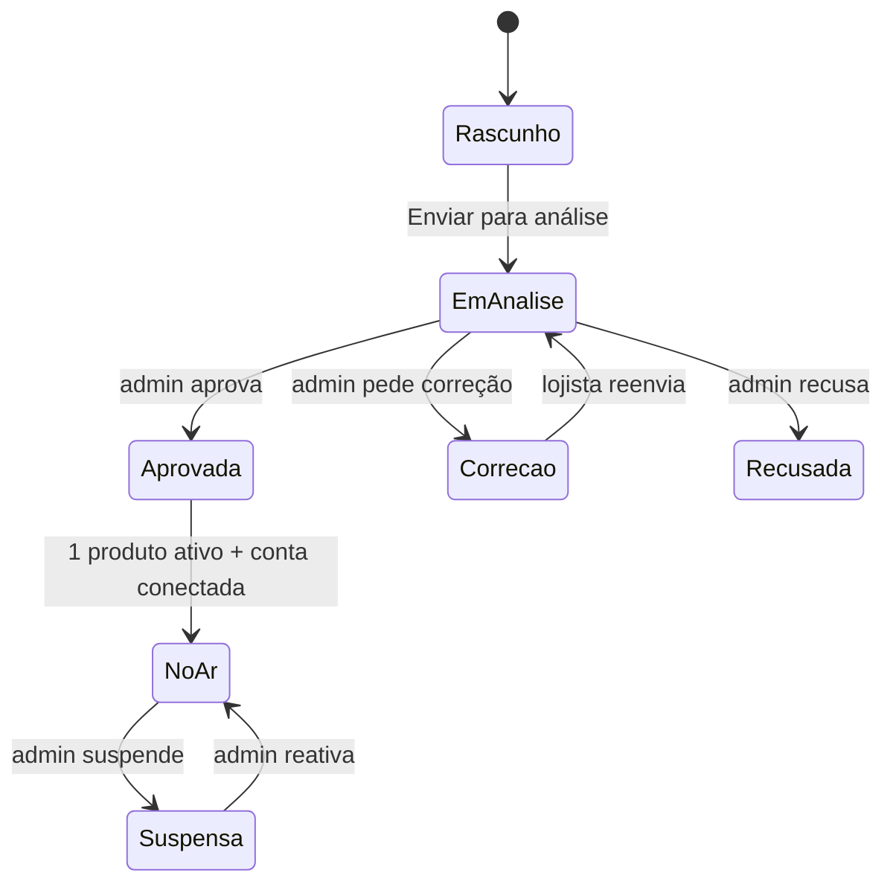
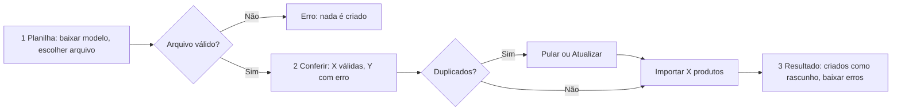

# Telas da Onda 2: lojista e admin (oferta)

> Autor: product-designer. Data: 2026-11-18. Histórias: WB-050 a 059, 060 a 066, 075, 103, 104, 107 (`docs/produto/prd/lojista.md`, `admin.md`). Base: `design-system.md` (v0.2.0), `identidade.md` §8, `fluxos.md` §4 e §5. Tokens: `packages/tokens/`. Itens **[HIPÓTESE]** estão listados na §Z. Plataforma: painel web responsivo (Next.js), mobile-first.
> O cadastro e login do cliente e os fluxos de onda 1 não estão aqui. A tela de criar conta do lojista (L1) segue a regra de DEC-012: senha + confirmação de senha.

## 0. Convenções (valem para todas as telas deste arquivo)

**0.1 Breakpoints.** Celular < 640: 1 coluna, barra inferior (lojista), ação principal fixa no rodapé. Tablet 640 a 1023: 1 coluna de até 640 centrada, barra inferior. Desktop ≥ 1024: barra lateral 240 + conteúdo (máx. 1200; formulário 480 a 640). Tudo funciona a 320 px sem rolagem horizontal. Admin: só usa o layout desktop como referência; em celular as tabelas viram lista de linhas (`design-system.md` §3.1 DataTable).

**0.2 Estados padrão (EP).** Cada tela abaixo lista o que é específico; onde diz "EP", vale o padrão:

| Estado | Padrão |
|---|---|
| Skeleton | Forma idêntica ao conteúdo, mín. 300 ms, após 8 s vira erro de rede lenta ("Está demorando. Sua conexão parece lenta." + "Tentar de novo") |
| Erro ao carregar | ErrorState: "Não conseguimos carregar agora." / "Seus dados estão salvos. Tente de novo em instantes." / "Tentar de novo" |
| Erro ao salvar | Banner de erro acima do botão: "Não foi possível salvar. O que você digitou continua aqui." + "Tentar de novo" |
| Offline | Banner `warning.subtle` sob o header: "Sem conexão. Mostrando o que já carregou." Formulário guarda rascunho no aparelho. Botão de rede fica ativo; ao tocar: "Conecte-se para salvar. O que você digitou está salvo neste aparelho." |
| Sessão expirada | "Entre de novo para continuar." / "Por segurança, sua sessão terminou. O que você digitou foi guardado." / "Entrar". Volta à mesma tela com o formulário restaurado |
| Sem acesso | ErrorState "Você não tem acesso a essa área" / lojista: "Peça ao dono da loja para liberar." / admin: "Peça ao administrador para liberar seu perfil." / "Voltar ao painel" |

**0.3 Acessibilidade padrão.** Foco no título (h1) ao abrir a tela; "Pular para o conteúdo"; erros: resumo no topo (`role="alert"`) e foco no 1º campo inválido; rótulo sempre acima do campo; alvo ≥ 48 (≥ 40 só em tabela desktop com ponteiro); barra fixa não cobre campo em foco; zoom 200% e reflow em 320 px; estado nunca só por cor.

**0.4 Rótulos de teste.** `data-testid="<papel>.<tela>.<elemento>"` em kebab-case (papel: `lojista` ou `admin`). Botão principal termina em `-submit`; cancelar em `-cancel`; item de lista em `-item-<id>`. Os IDs citados abaixo omitem o prefixo `lojista.<tela>.` ou `admin.<tela>.` quando for o caso e trazem só o sufixo.

**0.5 Analytics.** Eventos do PRD (`lojista.md`), sem dado pessoal; citados por tela só quando a tela cria evento.

**0.6 Cabeçalho do painel do lojista (todas as telas).** Logo + nome da loja; **chip de estado da loja** "Aberta" ou "Pausada até 15:30" (1 toque abre a folha "Pausar loja", ver C3); ícone Ajuda. Faixas globais acima do conteúdo, em ordem de prioridade: loja suspensa (erro), som desligado e conexão caída (erro, ver P1), loja pausada (alerta), sem horário (alerta). Máx. 1 faixa visível por vez.

---

## Parte A. Onboarding do lojista (WB-050 a 054)

Estrutura: **Conta** (L1, L2) e depois 4 etapas do FormWizard ("Etapa 1 de 4"): Quem é você, Sua loja, Documentos, Receber; e a Revisão. Rascunho automático ("Salvo às 14:32"); o lojista pode sair e voltar pelo e-mail e retoma da etapa em que parou ("Continuar de onde parou"). Total de campos digitados: conta 5 + etapa 1 (2 ou 3) + etapa 2 (5) = **12 a 13 campos, mais 3 ou 4 documentos** (meta ≤ 14, `fluxos.md` §2). Logo e capa ficam fora do onboarding (entram em Minha loja, C2): menos campos antes de enviar.

### L1. Criar conta de lojista (WB-050)

**Objetivo:** abrir a conta para cadastrar a loja. **Ação principal:** "Criar conta".

| Breakpoint | Layout |
|---|---|
| Celular | Header com logo e link "Já tem conta? Entrar". Título `title1` "Cadastre sua loja no Webag". 1 linha: "Leva cerca de 10 minutos. Você pode parar e voltar depois." Formulário. Botão `lg` fixo no rodapé |
| Desktop | 2 colunas (≥ 1024): esquerda, 3 fatos com ícone (`Storefront` "Cadastro em 4 etapas", `Clock` "Resposta em até 2 dias úteis", `Package` "Cadastre produtos enquanto a loja é analisada"); direita, formulário 480. Sem foto nem promessa de venda |

**Campos (nesta ordem; "Próximo" no teclado avança):** Nome completo (`name`) · E-mail (`email`) · Celular (máscara `(00) 00000-0000`, teclado de telefone) · Senha (PasswordField com medidor: "Fraca", "Média" ou "Forte") · **Confirmar senha** · caixa "Tenho 18 anos ou mais e aceito os Termos do lojista e a Política de Privacidade" (os dois links abrem em tela própria e voltam sem perder o formulário).
- Um único olho (Mostrar/Ocultar) controla senha e confirmação juntas. Colar e gerenciador de senhas permitidos nas duas.
- Confirmação: valida ao sair do campo ou quando o tamanho se iguala ao da senha. Igual: check + "As senhas são iguais". Diferente: "As senhas não são iguais."
- Medidor: abaixo de 8 caracteres ou senha comum, "Fraca" com texto "Use 8 caracteres ou mais, com letras e números." O botão **continua ativo**; ao tocar com senha fraca, rola até o campo e mostra o erro (regra do design system: botão não nasce desabilitado sem motivo visível).

**Mensagens:** "Digite seu nome." · "Confira o e-mail." (+ sugestão "Quis dizer gmail.com?") · "Confira o celular com DDD." · "Senha fraca. Use 8 caracteres ou mais, com letras e números." · "Marque a caixa para continuar."

**Caso C2 (e-mail já é de cliente):** erro no campo "Esse e-mail já tem conta Webag." + botão secundário "Entrar e abrir minha loja". Leva ao login com o e-mail preenchido; após entrar, segue para a Etapa 1 sem recriar conta.

| Estado | Comportamento |
|---|---|
| Skeleton | Formulário estático, sem skeleton. O botão entra em "Criando conta…" (spinner, inerte) |
| Vazio / flag desligada (C3) | EmptyState `Storefront`: "Cadastro de lojas indisponível" / "Estamos organizando a entrada de novas lojas." Campo E-mail + caixa (desmarcada) "Quero receber um aviso por e-mail quando o cadastro abrir." + botão "Entrar na lista de espera". Sucesso: "Anotado. Avisamos por e-mail." |
| Erro | EP salvar. Campos preservados. Muitas tentativas: "Muitas tentativas. Espere alguns minutos e tente de novo." |
| Offline | EP. Rascunho local; senha nunca é guardada no rascunho |
| Sucesso | Vai para L2 (código). Haptic success no celular |
| Permissão | n/a |

**A11y:** ordem: nome, e-mail, celular, senha, confirmar, caixa, botão; `autocomplete` `name`, `email`, `tel`, `new-password` (nas duas senhas), medidor lido como "Força da senha: média"; links de termos com texto "Termos do lojista" (nunca "clique aqui"). **testID:** `name-input`, `email-input`, `phone-input`, `password-input`, `password-confirm-input`, `password-toggle`, `terms-checkbox`, `submit`, `waitlist-email-input`, `waitlist-submit`. **Analytics:** `merchant_signup_started`, `merchant_signup_completed`.

### L2. Confirmar e-mail com código (WB-050 C4)

**Objetivo:** provar que o e-mail é dele. **Ação principal:** digitar ou colar o código (verifica sozinho no 6º dígito; sem botão).
- **Layout:** título "Confirme seu e-mail"; texto "Enviamos um código de 6 dígitos para marcos@casabela.com.br." OTPInput; abaixo "Reenviar código em 0:30" (vira link "Reenviar código"); link "Trocar e-mail".
- **Validade:** 10 min. Texto discreto: "O código vale por 10 minutos."

| Estado | Comportamento |
|---|---|
| Skeleton | n/a; as 6 caixas aparecem com o foco na 1ª, e a linha "Enviando o código…" até chegar a confirmação do envio |
| Vazio | n/a |
| Erro | Código errado: "Código incorreto. Restam 3 tentativas." (caixas em borda `border.danger`, limpam, foco na 1ª). 5 erros: "Muitas tentativas. Peça um novo código." + botão "Enviar novo código". Vencido: "Código vencido. Peça outro." Limite de reenvio (5 por hora): "Você pediu muitos códigos. Tente de novo em 40 minutos." |
| Offline | "Sem conexão. Conecte-se para confirmar." As caixas mantêm o que foi digitado |
| Sucesso | Check 400 ms e vai à Etapa 1 (L3) |
| Permissão | n/a |

**A11y:** cada caixa "Dígito 1 de 6"; erro anunciado como alerta; `one-time-code`. Contador de reenvio anunciado só ao liberar. **testID:** `otp-input`, `otp-resend`, `otp-change-email`.

### L3. Etapa 1 de 4: Quem é você (WB-051 C1, C2, C5)

**Objetivo:** informar CPF ou CNPJ. **Ação principal:** "Continuar".

| Breakpoint | Layout |
|---|---|
| Celular | Header "Etapa 1 de 4" + barra de progresso `brand.600`; título "Quem vai vender?"; campos; rodapé fixo: "Voltar" (texto) e "Continuar" (`lg`) |
| Desktop | Formulário 480 centrado; mesmo conteúdo; rodapé de ações dentro do fluxo, não fixo |

**Campos:** segmentado "CPF" | "CNPJ (MEI incluso)" · Número (máscara, teclado numérico) · se CNPJ: Razão social (preenchida pela consulta quando disponível **[HIPÓTESE]**, editável) e caixa "Sei que minha loja é responsável pelas notas fiscais e pelos impostos das vendas." (aceite registrado, C5).
**Mensagens:** "Confira o CPF." · "Confira o CNPJ. Os números não conferem." · duplicado (C2): "Esse CPF/CNPJ já tem loja." + link "Falar com o suporte" (abre WhatsApp do Webag).

| Estado | Comportamento |
|---|---|
| Skeleton | Consulta do CNPJ: campo Razão social em skeleton com "Buscando dados…" (≤ 5 s); se falhar, campo editável sem erro |
| Vazio | n/a |
| Erro | EP salvar; duplicado como acima |
| Offline | EP; validação de dígitos continua local; consulta e duplicidade esperam a rede |
| Sucesso | "Salvo às 14:32" e avança para L4 |
| Permissão | n/a |

**A11y:** o segmentado é um grupo de rádio ("Tipo de documento"); trocar CPF/CNPJ limpa o número e anuncia "CNPJ selecionado". **testID:** `type-cpf`, `type-cnpj`, `document-input`, `legal-name-input`, `fiscal-checkbox`, `submit`, `back`. **Analytics:** `onboarding_step_completed {step:1}`.

### L4. Etapa 2 de 4: Sua loja (WB-051 C3)

**Objetivo:** nome, categoria, contato e endereço da loja. **Ação principal:** "Continuar".
- **Layout:** igual a L3. Campos na ordem: Nome da loja (até 60) · Categoria principal (lista das categorias ativas do admin; no celular abre seletor nativo; sem pesquisa se ≤ 12 itens) · WhatsApp da loja (máscara; ajuda "É o número que o cliente usa para falar com você.") · CEP (AddressField: ao completar 8 dígitos, preenche rua, bairro e cidade com skeleton) · Número (+ caixa "Sem número") · Complemento (opcional, 80).
- **Endereço sem coordenada:** se a geocodificação falhar ou o ponto cair fora da cidade, abre o MapPinPicker "Confirme onde fica a loja" (ADR-008 item 5): arrastar o mapa, botões + e − de zoom, botão "Confirmar ponto". Quando funciona, aparece só o link "Ajustar ponto no mapa".
- **Cidade fora das regiões ativas (C3):** o campo Cidade fica com erro e abre o bloco: "Ainda não atendemos Mairiporã." / "Deixe seu e-mail para avisarmos quando chegarmos." (e-mail da conta já preenchido; consentimento explícito em caixa desmarcada) / botão "Avisar quando chegar". O "Continuar" fica ativo, mas ao tocar repete a explicação.

| Estado | Comportamento |
|---|---|
| Skeleton | Rua, bairro e cidade em skeleton + "Buscando CEP…" no campo |
| Vazio | n/a |
| Erro | "Não achamos esse CEP. Preencha rua e bairro." (campos liberados). Categorias não carregaram: campo com "Não conseguimos carregar as categorias." + "Tentar de novo" |
| Offline | EP; CEP não consulta: "Sem conexão. Preencha rua e bairro à mão." |
| Sucesso | "Salvo às 14:32" e avança |
| Permissão | n/a (mapa não usa localização do aparelho aqui) |

**A11y:** MapPinPicker tem alternativa por teclado (setas movem o ponto de 10 m; botão "Usar o endereço digitado") e texto "Ponto escolhido: Rua das Palmeiras, 120". **testID:** `name-input`, `category-select`, `whatsapp-input`, `cep-input`, `number-input`, `no-number-checkbox`, `complement-input`, `map-confirm`, `waitlist-submit`, `submit`.

### L5. Etapa 3 de 4: Documentos (WB-052, WB-218)

**Objetivo:** enviar os documentos pelo celular. **Ação principal:** "Continuar".
- **Itens (DocSlot):** CPF: "Documento com foto, frente" · "Documento com foto, verso" (RG ou CNH) · "Comprovante de endereço da loja". CNPJ: "Cartão CNPJ" · "Documento do responsável, frente" · "Documento do responsável, verso".
- **Cada DocSlot:** miniatura 96 + título + estado + ação. Botões "Tirar foto" (celular) e "Escolher arquivo". Aceita JPG, PNG e PDF até 5 MB (mostrado **antes** do envio: "JPG, PNG ou PDF, até 5 MB").
- **Pré-visualização (C4):** ao escolher, mostra a imagem grande com "Está legível?" e botões "Usar esta" (primário) e "Tirar outra". Sem pré-visualização para PDF (mostra nome e páginas).
- **Dica:** "Fotografe com boa luz e sem cortar as bordas." Aviso de foto escura **[HIPÓTESE]**: "A foto ficou escura. Tente perto de uma janela."
- **Privacidade:** "Só a equipe do Webag vê seus documentos."
- **Continuar** fica ativo; se faltar item, rola até o primeiro e mostra "Falta enviar o verso do documento." (Ver a11y).

| Estado do DocSlot | Aparência |
|---|---|
| Vazio | Área tracejada com ícone `UploadSimple`, título do item e os 2 botões |
| Enviando | Barra de progresso com % e botão "Cancelar" |
| Enviado | Miniatura, `CheckCircle` + "Enviado", nome e tamanho, link "Trocar" |
| Erro | `WarningCircle` + motivo + "Enviar outro": "Esse arquivo tem 8 MB. O máximo é 5 MB." · "Use uma foto (JPG ou PNG) ou PDF." · "Não foi possível enviar. Tentar de novo." Falha de um slot não derruba os outros |

| Estado da tela | Comportamento |
|---|---|
| Skeleton | Slots em skeleton enquanto carrega o rascunho |
| Vazio | Todos os slots vazios (estado normal) |
| Erro | EP; arquivos já enviados permanecem |
| Offline | Envio pausa: "Sem conexão. Retomamos o envio quando você voltar." Arquivos escolhidos ficam na fila local |
| Sucesso | Todos enviados: faixa `success.subtle` "Documentos enviados." e avança |
| Permissão negada | Câmera: "Sem acesso à câmera. Escolha uma foto da galeria." + link "Abrir ajustes" (no celular) |

**Modo correção (WB-054 C3):** o admin marcou itens com problema. A tela mostra só esses slots editáveis, cada um com o motivo em Banner de alerta acima ("A foto do verso está cortada. Tire outra foto."); os conferidos aparecem como "Conferido" e fechados. Botão: "Reenviar para análise".
**A11y:** cada slot é um grupo ("Documento com foto, frente: enviado"); progresso anunciado em 25%, 50%, 100%. **testID:** `slot-<id>`, `slot-<id>-camera`, `slot-<id>-file`, `slot-<id>-replace`, `preview-accept`, `preview-retake`, `submit`. **Analytics:** `merchant_upload_failed {motivo}`.

### L6. Etapa 4 de 4: Receber (WB-053)

**Objetivo:** ligar a conta onde ele recebe. **Ação principal:** "Conectar Mercado Pago". Secundária (texto): "Conectar depois".
- **Layout (modo split, padrão do ADR-002):** título "Onde você recebe?"; 3 linhas com ícone: `Wallet` "Você recebe direto na sua conta Mercado Pago." · `Receipt` "O Webag desconta a comissão de cada venda." · `Lock` "Você não precisa dar sua senha ao Webag." Botão primário. Link "Conectar depois": "A loja só vai ao ar depois de conectar."
- **Ao tocar:** abre o Mercado Pago na mesma aba (OAuth) e volta a esta tela por link; o estado do onboarding é preservado.
- **Modo centralizado (fallback do ADR-002, só se ativado):** campos "Tipo da chave PIX" (CPF, CNPJ, e-mail, celular, aleatória) + "Chave PIX"; erro de titular: "O titular dessa conta não é o mesmo CPF/CNPJ da loja. Use uma conta no seu nome."
- **Só o dono** vê esta etapa; dados ficam mascarados ("Conta final 4821") e trocar exige senha (diálogo "Digite sua senha para trocar a conta de recebimento").

| Estado | Comportamento |
|---|---|
| Skeleton | Bloco do status em skeleton ao voltar do Mercado Pago ("Conferindo a conexão…") |
| Vazio | Estado inicial: não conectada |
| Erro | Negou a autorização: banner de alerta "Você não autorizou a conexão. Sem ela, a loja não recebe." + "Tentar de novo". Conta sem nível: "Sua conta Mercado Pago ainda não pode receber pelo Webag. Abra o app do Mercado Pago, complete o cadastro e tente de novo." + link "Ver como resolver". Provedor fora do ar: EP |
| Offline | "Conecte-se para conectar sua conta." (botão ativo) |
| Sucesso | `CheckCircle` + "Conta conectada" + conta mascarada. Simulado: "Conta de teste conectada" |
| Permissão | n/a |

**A11y:** ao voltar do OAuth o foco vai ao resultado, que é anunciado. **testID:** `connect-mp`, `connect-later`, `connected-status`, `pix-key-type`, `pix-key-input`, `submit`. **Analytics:** `merchant_connected_mp`.

### L7. Revisão e envio (WB-051 a 054; fluxos §4)

**Objetivo:** conferir tudo e enviar. **Ação principal:** "Enviar para análise".
- **Layout:** título "Confira e envie"; 4 blocos (Quem é você, Sua loja, Documentos, Receber), cada um com resumo em 2 linhas e link "Editar" (volta à etapa e retorna à revisão). Documentos como miniaturas. Receber: "Conta conectada" ou "Falta conectar" (alerta).
- **Se Receber pendente:** Banner info "Falta conectar o Mercado Pago. Você pode enviar agora; a loja só vai ao ar depois de conectar."
- **Se algo faltar:** botão continua ativo; ao tocar, mostra a lista "Falta: verso do documento (Etapa 3)" com links.
- **Tela de sucesso:** `CheckCircle` Fill 64, "Recebemos seu cadastro" (`title1`), "Respondemos em até 2 dias úteis." (prazo vem da configuração), botão primário "Cadastrar produtos", link "Ver andamento".

| Estado | Comportamento |
|---|---|
| Skeleton | Blocos em skeleton ao abrir |
| Vazio | n/a |
| Erro | EP salvar; o rascunho permanece e "Enviar para análise" volta ativo |
| Offline | "Conecte-se para enviar. Seu cadastro está salvo." |
| Sucesso | Tela acima; haptic success; e-mail de confirmação |
| Permissão | n/a |

**testID:** `section-<id>`, `section-<id>-edit`, `missing-list`, `submit`, `success-add-products`, `success-status`. **Analytics:** `store_submitted`.

### L8. Início enquanto a loja não está no ar: acompanhar aprovação (WB-054)

**Objetivo:** saber em que pé está e o que fazer. **Ação principal:** varia por estado (tabela). É o Início do lojista até a loja ir ao ar; depois dele, o painel (WB-078, onda 5) ocupa o lugar.

| Estado da loja | O que a tela mostra | Ação principal |
|---|---|---|
| Em análise | StatusTimeline de 3 passos (Enviada, Em análise, Resposta). "Respondemos em até 2 dias úteis." "Enviado em 18 nov, 10:15." | "Cadastrar produtos" (tempo morto vira trabalho útil) |
| Correção pedida | Banner de alerta "Precisamos de uma correção." Lista de itens com o motivo do admin e botão "Corrigir" em cada um. Os já corrigidos mostram `CheckCircle` | "Reenviar para análise" (se faltar item, rola ao primeiro e mostra "Falta corrigir: verso do documento.") |
| Recusada | Ícone `XCircle` em `feedback.danger` + "Sua loja não foi aprovada." + motivo escrito pelo admin | "Falar com o suporte" (WhatsApp do Webag) |
| Aprovada, ainda fora do ar | Título "Sua loja foi aprovada." Faixa "Falta pouco para aparecer no app" com 3 verificações: Loja aprovada (feito) · "Cadastre 1 produto" · "Conecte o Mercado Pago". Abaixo, as 3 tarefas com progresso "1 de 3": "Cadastrar o primeiro produto", "Definir horário", "Testar o som dos pedidos" | A 1ª tarefa pendente ("Cadastrar o primeiro produto") |
| No ar | Banner de sucesso "Sua loja está no ar." (dispensável) e o painel completo | n/a |
| Suspensa | Banner de erro "Sua loja foi suspensa." + motivo. Pedidos em andamento continuam visíveis | "Falar com o suporte" |

| Estado da tela | Comportamento |
|---|---|
| Skeleton | Timeline e lista de tarefas em skeleton |
| Vazio | Aprovada sem produto: "Cadastre 1 produto para aparecer no app." (C4) com botão "Adicionar produto" |
| Erro / Offline | EP; o último status fica visível com "Atualizado às 14:32" |
| Sucesso | Mudança de status: toast "Sua loja foi aprovada." + e-mail e notificação |
| Permissão | Funcionário vê o status sem os dados do cadastro (documentos, recebimento) |

**Layout:** celular em 1 coluna; desktop (≥ 1024) 2 colunas: status e tarefas à esquerda, resumo do cadastro à direita (somente leitura). **testID:** `status-card`, `corrections-list`, `correction-<id>`, `resubmit`, `task-<id>`, `support-link`. **Analytics:** `store_approved`/`store_rejected` (recebidos do servidor), `onboarding_task_completed {task}`.

### L9. Equipe: lista e convite (WB-075)

**Objetivo:** dar acesso a funcionários sem dar acesso ao dinheiro. **Ação principal:** "Convidar funcionário". **Só o dono** vê (RN-13).
- **Layout:** título "Equipe"; lista (ListItem 72): avatar com iniciais, nome, e-mail, permissões como selos (`Pedidos`, `Catálogo e estoque`, `Trocas`, `Cupons`, `Avaliações`) e status ("Ativo" ou "Convite enviado · vence em 5 dias"). A linha do dono aparece primeiro, sem ação ("Dono"). Desktop: tabela. Ação por linha no menu `DotsThree` ("Editar permissões", "Reenviar convite", "Cancelar convite", "Remover da equipe").
- **Folha "Convidar funcionário":** E-mail · Nome (opcional) · permissões (caixas, **só "Pedidos" marcada** por padrão) · texto "O funcionário nunca vê financeiro, conta de recebimento, equipe nem configurações da loja." · botão "Enviar convite". Link do convite vale 7 dias.
- **Remover:** Dialog "Remover Joana?" / "Ela perde o acesso agora." / "Remover da equipe" (destrutivo) + "Cancelar". Pede a senha do dono.

| Estado | Comportamento |
|---|---|
| Skeleton | 3 linhas de skeleton |
| Vazio | EmptyState `UsersThree`: "Você trabalha sozinho por enquanto" / "Convide quem atende os pedidos com você." / "Convidar funcionário" |
| Erro | E-mail já usado em outra loja (C4): "Esse e-mail já participa de outra loja." Convite duplicado: "Já existe um convite para esse e-mail." EP no resto |
| Offline | EP; ações bloqueadas com "Conecte-se para alterar a equipe." |
| Sucesso | Toast "Convite enviado para joana@exemplo.com." / "Permissões salvas." / "Joana foi removida." |
| Permissão | Funcionário: Sem acesso (EP). Pede senha de novo para remover e alterar permissões |

**A11y:** caixas de permissão em grupo "Permissões de Joana". **testID:** `invite-open`, `invite-email-input`, `invite-name-input`, `perm-orders`, `perm-catalog`, `perm-exchanges`, `perm-coupons`, `perm-reviews`, `invite-submit`, `member-<id>`, `member-<id>-menu`, `remove-confirm`.

### L10. Aceitar convite (WB-075 C1)

**Objetivo:** o funcionário cria a senha e entra. **Ação principal:** "Criar senha e entrar".
- **Layout:** "Joana, você foi convidada para a Casa Bela." Campos: Senha, **Confirmar senha** (DEC-012), um olho para as duas. Texto "Você terá acesso a: Pedidos e Trocas." Botão.
- **Estados:** link vencido: ErrorState `Clock` "Esse convite venceu." / "Peça um novo ao dono da loja." / sem ação (texto). Link já usado: "Esse convite já foi usado." + "Entrar". Erro de rede e offline: EP. Skeleton: o texto do convite em skeleton enquanto valida o link. Sucesso: entra no painel com só o que tem permissão. Vazio e permissão: n/a.
- **testID:** `password-input`, `password-confirm-input`, `password-toggle`, `submit`.

---

## Parte B. Admin: aprovação e moderação (WB-103, 104, 107)

### A1. Fila de aprovação de lojas (WB-103)

**Objetivo:** pegar a próxima loja e decidir. **Ação principal:** "Analisar a mais antiga" (abre o caso mais antigo da aba atual).

| Breakpoint | Layout |
|---|---|
| Celular | Título "Fila de aprovação"; Tabs "Para analisar (5)" e "Aguardando lojista (2)"; busca; lista de linhas: nome da loja, cidade, "há 1 d 4 h", selo de prazo. Botão principal fixo no rodapé |
| Desktop | DataTable. Colunas: Loja (nome + CPF/CNPJ mascarado), Cidade, Enviada há, Prazo (selo), Origem ("Nova" ou "Reenviada"), "Abrir". Ordem padrão: mais antiga primeiro. Botão principal no cabeçalho da página. Linha inteira é o alvo |

- **Selo de prazo** (ícone + texto): "No prazo" (neutro), "Vence hoje" (`warning`), "Atrasada 1 dia" (`danger`), conforme `aprovacao_loja_sla_dias_uteis`. Em "Aguardando lojista", o prazo está pausado: "Prazo pausado".
- **Selo de risco:** "CNPJ repetido" (alerta) quando a checagem de duplicidade encontra outra loja.
- **Filtros (chips):** Todas · Novas · Reenviadas · Atrasadas. Busca por nome, cidade ou CPF/CNPJ. Atualizada "às 10:42" + botão "Atualizar".
- **Perfis:** operação e super admin veem "Analisar a mais antiga" e "Abrir"; suporte e financeiro veem "Ver" (leitura).

| Estado | Comportamento |
|---|---|
| Skeleton | 6 linhas de skeleton (tabela com cabeçalho real) |
| Vazio | EmptyState `CheckCircle`: "Fila em dia" / "Nenhuma loja esperando análise." / "Ver lojas ativas" |
| Sem resultado de filtro | "Nenhuma loja neste filtro." + "Limpar filtros" |
| Erro / Offline | EP; lista em cache com "Atualizada às 10:42" |
| Sucesso | Ao voltar de uma decisão: toast "Casa Bela aprovada." na lista |
| Permissão | Perfil sem acesso: Sem acesso (EP admin) |

**A11y:** tabela com cabeçalhos e ordenação anunciada ("ordenado por mais antiga"). **testID:** `analyze-oldest`, `tab-pending`, `tab-waiting`, `search-input`, `filter-<id>`, `row-<id>`, `row-<id>-open`, `refresh`. **Analytics:** `admin_case_opened`.

### A2. Caso de aprovação (WB-103 C2 a C4; fluxos §5)

**Objetivo:** conferir os documentos e decidir em até 90 s. **Ação principal:** "Aprovar loja" (liberada só com a checklist completa).

| Breakpoint | Layout |
|---|---|
| Desktop (≥ 1024) | 2 painéis: esquerda (≥ 55%) **DocumentViewer** com miniaturas dos documentos acima, zoom, girar, tela cheia, baixar; direita (400, rolável) com Dados da loja, **Checklist**, Comissão e Ações. Documento e formulário lado a lado, sem trocar de aba |
| Celular e tablet | Tabs "Documentos" · "Dados" · "Decisão". Rodapé fixo com o resumo "Conferido 4 de 6" e o botão da aba "Decisão" |

**Dados (somente leitura, mascarados com "Revelar", que registra o acesso):** nome, CPF/CNPJ, razão social, categoria, endereço, WhatsApp, e-mail e celular do responsável, cidade ativa? (sim/não), duplicidade (sim/não).

**Checklist (ApprovalChecklist), 6 itens, cada um "Conferido" ou "Problema":** Documento legível · CPF/CNPJ confere com o documento e está ativo · Endereço da loja confere · Categoria adequada · Nome e WhatsApp válidos · Loja sem duplicidade. Marcar "Problema" abre campo curto "O que está errado?" e liga o item a um campo do cadastro (para o lojista saber o que corrigir).

**Ações (de cima para baixo):** texto de apoio "Conferido 4 de 6" · **Aprovar loja** (primário `lg`; sob o botão, enquanto incompleto: "Confira os 6 itens para aprovar.") · "Pedir correção" (secundário; ativo quando há item com Problema) · "Recusar loja" (texto destrutivo). Comissão: "Comissão: 12% (padrão da plataforma)", somente leitura; a edição entra com WB-105 (onda 4).

**Diálogos:**
| Ação | Título e texto | Botões |
|---|---|---|
| Aprovar | "Aprovar Casa Bela?" / "O lojista é avisado por e-mail. A loja só aparece para clientes com 1 produto ativo e conta de recebimento conectada." | "Aprovar loja" (primário) · "Cancelar" |
| Pedir correção | Lista dos itens com Problema + mensagem editável, já preenchida: "A foto do verso do documento está cortada. Tire outra foto com a borda inteira." (mín. 10 caracteres) | "Pedir correção" · "Cancelar" |
| Recusar | Campo obrigatório "Motivo (o lojista vai ler)" com opções rápidas (Documento inválido, Dados não conferem, Loja duplicada, Atividade não permitida, Outro) + texto. Título "Recusar Casa Bela?" | "Recusar loja" (destrutivo) · "Cancelar" |

| Estado | Comportamento |
|---|---|
| Skeleton | Visualizador com bloco cinza do tamanho do documento; painel com linhas de skeleton |
| Vazio | Sem documento enviado (não deveria ocorrer): "Nenhum documento enviado." e "Pedir correção" é a única decisão possível |
| Erro | Documento não abriu: no visualizador "Não foi possível abrir o documento." + "Tentar de novo". Link expirou (URL assinada de poucos minutos): "A visualização expirou. Abrir de novo." Falha ao salvar a decisão: "Não foi possível salvar. Sua decisão não foi perdida." + "Tentar de novo" |
| Conflito (C4) | Dialog: "Esta loja já foi decidida por Ana às 10:42." + "Ver decisão" e "Voltar à fila" |
| Offline | Marcações da checklist ficam no aparelho. Decisões: "Conecte-se para decidir. Suas marcações estão salvas." |
| Sucesso | Toast "Casa Bela aprovada. Próxima loja da fila." e abre o próximo caso (ou volta à fila vazia). Sem "desfazer" (o e-mail já saiu) |
| Permissão | Suporte e financeiro: documento e dados visíveis, sem ações; faixa "Você pode ver este caso, mas não decidir." |

**Atalhos:** `a` aprova (só com checklist completa, abre o diálogo), `j` e `k` trocam de documento, `?` lista os atalhos; todos têm botão equivalente. **A11y:** checklist com grupo de rádio por item; ao completar, anuncia "Checklist completa. Aprovar liberado."; o visualizador tem controles por teclado (`+`, `-`, `r` girar). **testID:** `doc-viewer`, `doc-thumb-<id>`, `check-<id>-ok`, `check-<id>-problem`, `check-<id>-note`, `approve`, `request-correction`, `reject`, `reveal-<campo>`, `confirm-approve`, `reject-reason`. **Analytics:** `admin_store_approved`, `admin_correction_requested`, `admin_store_rejected` (com segundos até a decisão). Toda decisão vai à auditoria (WB-123).

### A3. Loja no admin: detalhe, suspender, reativar, editar (WB-104)

**Objetivo:** corrigir ou proteger clientes. **Ação principal:** "Editar dados" (loja no ar) ou "Reativar loja" (loja suspensa).

| Breakpoint | Layout |
|---|---|
| Celular | Header com nome e selo de status; Tabs "Resumo", "Dados", "Documentos", "Histórico"; ações no menu `DotsThree` |
| Desktop | Cabeçalho (logo, nome, status, cidade) + ação principal + menu "Mais" (Suspender loja); abaixo, Tabs e conteúdo em 2 colunas (dados à esquerda, atividade à direita: pedidos em andamento, repasse pendente) |

- **Resumo:** status, comissão efetiva "12% · padrão" (somente leitura até WB-105), pedidos em andamento, saldo a receber.
- **Suspender (menu "Mais"):** Dialog "Suspender Casa Bela?" / "A loja some do app agora e não recebe novos pedidos. 3 pedidos em andamento precisam de ação." (link "Ver pedidos") / motivo obrigatório (lista + texto) / "Suspender loja" (destrutivo) + "Cancelar". Repete o nome como confirmação (`design-system.md` §9). O lojista é avisado.
- **Reativar:** Dialog "Reativar Casa Bela?" / "Ela volta ao app se continuar atendendo as regras de visibilidade." / "Reativar loja".
- **Editar (C3):** abre os mesmos formulários do lojista (C2, C3, C4, C5, C6) em "modo admin" com faixa "Você está editando como administrador. A alteração fica registrada." Ao salvar: Dialog com o antes e depois ("Raio: 5 km → 8 km"), motivo curto obrigatório e "Salvar alteração".
- **Repasse pendente (C4):** Banner info "Esta loja tem R$ 1.240,00 a receber. A suspensão não apaga o saldo. O financeiro foi avisado."

| Estado | Comportamento |
|---|---|
| Skeleton | Cabeçalho e blocos em skeleton |
| Vazio | Aba Histórico sem eventos: "Nenhum evento ainda." |
| Erro / Offline | EP; ações bloqueadas offline com "Conecte-se para alterar a loja." |
| Sucesso | Toast "Casa Bela suspensa." / "Casa Bela reativada." / "Alteração salva." |
| Permissão | Só super admin e operação alteram; suporte e financeiro leem (botões ocultos) |

**testID:** `status-badge`, `edit`, `more-menu`, `suspend`, `suspend-reason`, `suspend-confirm`, `reactivate`, `reactivate-confirm`, `diff-list`, `edit-reason`, `edit-confirm`, `pending-orders-link`.

### A4. Moderação de produtos (WB-107)

**Objetivo:** tirar do ar o que não pode ser vendido. **Ação principal:** "Manter no ar" (a maior parte dos itens sinalizados é falso positivo; remover é sempre deliberado).

| Breakpoint | Layout |
|---|---|
| Celular | Lista de linhas: foto 56, nome, loja, selo (ex.: "Palavra proibida"), "2 denúncias". Toque abre o produto em tela cheia |
| Desktop | Tabela (foto 48, produto, loja, categoria, preço, data, sinal, denúncias, status) com Tabs "Revisar (7)", "Denunciados (3)", "Todos". Ao selecionar uma linha abre painel lateral (drawer 480) com a pré-visualização do produto como o cliente vê |

- **Painel do produto:** fotos, nome, preço, descrição, loja (link), motivo do sinal ("Palavra proibida: réplica" ou "Denúncia: produto proibido"). **Ações:** "Manter no ar" (primário) · "Pausar" (secundário) · "Remover produto" (texto destrutivo).
- **Remover:** Dialog "Remover Camiseta Réplica?" / "O produto sai do app e o lojista é avisado com o motivo." / Motivo obrigatório (lista + texto) / "Remover produto" (destrutivo). O lojista pode contestar por e-mail (texto do aviso).
- **Reincidência (C4):** Banner de alerta "Esta loja teve 3 remoções em 30 dias." + "Analisar suspensão" (leva a A3).
- **Regras de moderação (link "Regras" no cabeçalho):** tela com 2 listas editáveis, "Palavras proibidas" e "Categorias proibidas", cada uma com campo + "Adicionar", itens como chips com "x". Texto: "Produtos novos que combinarem entram em Revisar. Nada é bloqueado sozinho."

| Estado | Comportamento |
|---|---|
| Skeleton | Linhas de skeleton |
| Vazio | "Nada para revisar" / "Produtos sinalizados e denunciados aparecem aqui." / "Ver todos os produtos" |
| Sem resultado | "Nenhum produto neste filtro." + "Limpar filtros" |
| Erro / Offline | EP |
| Sucesso | Toast "Produto mantido no ar." / "Produto removido. O lojista foi avisado." / "Produto pausado." |
| Permissão | Operação e super admin agem; demais só leem |

**testID:** `tab-review`, `tab-reported`, `row-<id>`, `keep`, `pause`, `remove`, `remove-reason`, `remove-confirm`, `rules-link`, `rule-word-input`, `rule-word-add`, `rule-word-<id>-remove`. **Analytics:** `product_moderated {acao}`.

---

## Parte C. Configuração da loja (WB-055 a 059)

Padrão desta parte: **Minha loja** é o menu; cada seção é uma tela de formulário com **botão explícito "Salvar"** (as mudanças publicam na hora; autosalvar seria arriscado). Sair com alteração não salva abre o diálogo "Sair sem salvar?" / "Você tem alterações que não foram salvas." / "Continuar editando" (primário) e "Sair sem salvar".

### C1. Minha loja (menu)

**Objetivo:** achar e ajustar uma configuração. **Ação principal:** "Pausar loja" (ou "Reabrir loja" quando pausada).
- **Layout:** cartão de estado no topo: "Loja aberta · fecha às 18:00" com botão "Pausar loja" (md). Abaixo, ListItems com resumo à direita: Perfil da loja ("Logo, capa, descrição"), Horários e pausa ("Seg a sex, 9h às 18h"), Entrega e retirada ("Entrega até 5 km · Retirada ligada"), Política de trocas ("Troca em até 7 dias"), Recebimento (só dono: "Conta final 4821"), Equipe (só dono). Desktop: submenu fixo à esquerda (240) e a seção escolhida à direita; o cartão de estado fica no topo da coluna da direita.
- **Pendência** (selo de alerta no item): "Falta o horário" · "Falta conectar o Mercado Pago".

| Estado | Comportamento |
|---|---|
| Skeleton | Cartão e 6 linhas |
| Vazio | n/a (a tela sempre tem itens) |
| Erro / Offline | EP; resumo em cache |
| Sucesso | Ao salvar numa seção e voltar: toast "Alterações salvas." |
| Permissão | Funcionário não vê Minha loja (Sem acesso). Item Recebimento e Equipe só para o dono |

**testID:** `status-card`, `pause-open`, `reopen`, `item-profile`, `item-hours`, `item-delivery`, `item-exchange`, `item-payout`, `item-team`.

### C2. Perfil da loja (WB-055)

**Objetivo:** dar cara de loja. **Ação principal:** "Salvar alterações".

| Breakpoint | Layout |
|---|---|
| Celular | Capa 16:9 em cima (botão "Trocar capa" sobreposto, com scrim), logo 96 sobreposto à capa com botão "Trocar logo", depois campos; rodapé fixo com o botão |
| Desktop | Formulário 640 à esquerda; à direita "Como o cliente vê" (pré-visualização do cabeçalho da loja: capa, logo, nome, nota "Novo", categorias, selos); atualiza ao digitar |

**Campos:** Nome da loja · Descrição (até 300; contador "120 de 300") · Categoria principal (lista) + "Outras categorias" (até 2, chips selecionáveis) · WhatsApp (máscara). CPF/CNPJ aparece só para leitura com link "Pedir mudança" (abre WhatsApp do suporte).
**Mudar nome (C4):** ao salvar com o nome diferente, Dialog "Mudar o nome precisa de nova análise." / "O nome atual continua no ar até a resposta do Webag." / "Enviar para análise" (primário) · "Cancelar". Os demais campos publicam na hora. **[HIPÓTESE]**: o nome antigo permanece visível durante a análise.

**ImageCropper (logo 1:1, capa 16:9):** abre em folha/modal: moldura fixa com a proporção, arrastar para mover, controle de zoom (barra + botões + e − para quem não usa gesto), botão "Girar", prévia pequena do resultado, botões "Usar recorte" (primário) e "Cancelar". Origem até 5 MB; saída ≤ 300 KB, comprimida no navegador (progresso "Preparando a imagem…"). Formatos: JPG, PNG, WebP.

| Estado | Comportamento |
|---|---|
| Skeleton | Capa, logo e campos em skeleton |
| Vazio | Sem logo: círculo `surface.sunken` com iniciais; sem capa: placeholder `Image` + "Sem foto". Ajuda: "Uma foto da fachada ou do balcão passa mais confiança." |
| Erro | Upload falhou (C5): "Não foi possível enviar. Tentar de novo." A imagem anterior permanece. Arquivo grande: "Esse arquivo tem 8 MB. O máximo é 5 MB." Formato: "Use uma foto JPG, PNG ou WebP." |
| Offline | EP; troca de imagem exige rede: "Conecte-se para enviar a imagem." |
| Sucesso | Toast "Alterações salvas. Já valem para os clientes." |
| Permissão | Câmera/galeria negada: "Sem acesso às fotos. Libere nos ajustes do navegador." (web) |

**A11y:** o recorte tem alternativa por teclado (setas movem, `+`/`-` zoom) e texto de ajuda; imagens têm `alt` ("Logo da Casa Bela"). **testID:** `logo-change`, `cover-change`, `crop-zoom`, `crop-zoom-in`, `crop-zoom-out`, `crop-rotate`, `crop-accept`, `name-input`, `description-input`, `category-main`, `category-extra-<id>`, `whatsapp-input`, `preview`, `submit`.

### C3. Horários, feriados e pausa (WB-056)

**Objetivo:** abrir e fechar a loja sem erro. **Ação principal:** "Salvar horários".

**Layout (de cima para baixo, uma coluna até 640):**
1. **Pausar agora** (cartão): chips "30 min", "1 h", "2 h", "Até o fim do dia", "Até eu reabrir" + botão "Pausar loja". Também abre pelo chip do cabeçalho (0.6) em folha. Confirma: Dialog "Pausar a loja?" / "Pedidos em andamento continuam. Novos pedidos não entram." / "Pausar por 1 h" · "Cancelar". Pausada: o cartão vira "Pausada até 15:30" + botão "Reabrir agora"; faixa global amarela "Loja pausada até 15:30".
2. **Horário da semana:** atalhos "Seg a sex, 9h às 18h" e "Todos os dias, 9h às 18h" (preenchem a grade; 1 toque). 7 linhas (Segunda a Domingo): Switch "Aberto/Fechado" (texto, não só cor) + até 2 intervalos com TimeField (máscara `00:00`, teclado numérico, passos de 15 min) + "Adicionar 2º horário". Link "Copiar para outros dias" (folha com caixas de dias).
3. **Feriados e folgas:** lista de datas com motivo opcional ("Natal") e remover; botão "Adicionar data" (seletor nativo de data). A loja aparece "Fechada hoje" no app.

**Validações:** "O horário de fechar precisa ser depois do de abrir." · "Os dois horários não podem se sobrepor." · "Confira o horário (ex.: 09:00)."

| Estado | Comportamento |
|---|---|
| Skeleton | Grade de 7 linhas em skeleton |
| Vazio | Sem nenhum horário: Banner de alerta "Sua loja está sem horário e aparece como fechada." + os atalhos de preenchimento destacados |
| Erro / Offline | EP. Pausar offline: "Conecte-se para pausar a loja." (botão ativo) |
| Sucesso | Toast "Horários salvos." / "Loja pausada até 15:30." / "Loja reaberta." Reabre sozinha ao fim da pausa e avisa por toast se o painel estiver aberto |
| Permissão | Funcionário: Sem acesso, exceto o chip de pausa se o dono permitir **[HIPÓTESE: fora da 1.0]** |

**Nota (C6):** não há tela para "esqueci aberta"; o aviso é por e-mail ("Sua loja está aberta e ninguém respondeu") com link "Pausar loja". **A11y:** cada linha é um grupo ("Segunda: aberto, 09:00 às 12:00 e 14:00 às 18:00"). **testID:** `pause-chip-<min>`, `pause-submit`, `reopen`, `preset-weekdays`, `preset-all`, `day-<n>-switch`, `day-<n>-open-1`, `day-<n>-close-1`, `day-<n>-add-interval`, `copy-days`, `holiday-add`, `holiday-<id>-remove`, `submit`. **Analytics:** `store_paused {reason}`.

### C4. Entrega e retirada (WB-057, WB-058)

**Objetivo:** configurar frete sem prejuízo. **Ação principal:** "Salvar entrega e retirada". Entrega e retirada ficam na mesma tela (uma é pré-requisito da outra: ao menos uma deve ficar ligada).

| Breakpoint | Layout |
|---|---|
| Celular | Seção Entrega (Switch "Entregar em casa: Ligado/Desligado" com texto) e Seção Retirada, nessa ordem; "Prévia" ao final como cartão |
| Desktop | Formulário 640 à esquerda; "Prévia do cliente" fixa à direita |

**Entrega (quando ligada):**
- **Raio de entrega:** campo numérico em km com − e + (padrão 5; limite `raio_max_km`, 15). Erro: "O máximo é 15 km."
- **Taxa:** segmentado "Taxa fixa" | "Por distância". Fixa: moeda (R$ 0,00 a R$ 50,00; "Grátis" quando 0). Por distância: tabela de até 5 faixas. A coluna "De" é **automática** (igual ao "Até" da faixa anterior; 0 na primeira) e a última faixa termina **sempre no raio**: o lojista só digita "Até (km)" e "Valor"; assim não existe lacuna nem sobreposição. Botão "Adicionar faixa" (some no máximo de 5, com o texto "Máximo de 5 faixas") e "Remover" na última. Erro de segurança, se ocorrer: "As faixas precisam ser seguidas."
- **Pedido mínimo** (moeda, opcional) e **Entrega grátis a partir de** (moeda, opcional; erro: "Precisa ser maior que o pedido mínimo de R$ 30,00.").
- **Tempo estimado:** "De" e "Até" em minutos; ao lado, o texto vivo "30 a 45 min". Erros: "O mínimo precisa ser menor que o máximo." "O máximo é 1.440 minutos."
- **Prévia (C5):** campo CEP + Número → resultado "Para o CEP 07900-000 o cliente paga R$ 7,00 e recebe em 30 a 45 min (2,3 km)." ou "Fora do raio: o cliente não vê sua loja nesse endereço."

**Retirada (quando ligada):** Endereço de retirada (rádio "Usar o endereço da loja" ou "Outro endereço" com CEP) · Instruções (até 200, contador) · Tempo de preparo (de, até, em minutos) · texto fixo: "O cliente recebe um código de 4 dígitos. Peça o código para entregar o pedido."
**Regra de desligar (C6):** desligar a única opção ativa mostra, abaixo do Switch, "Ligue a entrega ou a retirada. A loja precisa de ao menos uma." e mantém o Switch ligado. Desligar a retirada com pedidos em andamento: aviso "Pedidos de retirada em andamento seguem normalmente."

| Estado | Comportamento |
|---|---|
| Skeleton | Seções em skeleton |
| Vazio | n/a (loja nova abre com padrões: entrega ligada, raio 5 km, taxa fixa R$ 0,00 **[HIPÓTESE]**) |
| Erro / Offline | EP; a prévia exige rede: "Conecte-se para ver a prévia." |
| Sucesso | Toast "Entrega e retirada salvas." |
| Permissão | Funcionário: Sem acesso |

**testID:** `delivery-switch`, `radius-input`, `fee-mode-fixed`, `fee-mode-distance`, `fee-input`, `band-<n>-to`, `band-<n>-fee`, `band-add`, `band-remove`, `min-order-input`, `free-above-input`, `eta-min-input`, `eta-max-input`, `preview-cep`, `preview-number`, `preview-result`, `pickup-switch`, `pickup-address-store`, `pickup-address-other`, `pickup-notes`, `pickup-prep-min`, `pickup-prep-max`, `submit`.

### C5. Política de trocas (WB-059)

**Objetivo:** definir as regras de troca por tamanho ou cor sem mexer no que é lei (DEC-011). **Ação principal:** "Salvar política".
- **Layout:** Switch "Aceito troca por tamanho ou cor: Ligado/Desligado". Quando ligado: Prazo em dias (− e + , 1 a 30, padrão 7) e Taxa de coleta (moeda, R$ 0,00 a R$ 30,00; ajuda: "Cobrada do cliente só se ele pedir a coleta em casa."). Cartão fixo (não editável, `info.subtle`, ícone `Scales`): "Valem sempre, por lei: arrependimento em até 7 dias e produto com defeito. Você não pode desligar." Prévia: "Como o cliente vê: Troca por tamanho ou cor em até 7 dias. Coleta em casa: R$ 5,00."
- **Desligar (C2):** os campos somem e o cartão fixo ganha destaque: "Arrependimento (7 dias) e defeito continuam valendo por lei." O prazo voluntário vira 0 (filtro "aceita troca" some para a loja).
- **Rodapé do formulário:** "A nova política vale para pedidos novos. Pedidos já feitos mantêm a política da época."

| Estado | Comportamento |
|---|---|
| Skeleton | Switch e campos em skeleton |
| Vazio | n/a (padrão: ligada, 7 dias, taxa R$ 0,00 **[HIPÓTESE]**) |
| Erro | "A taxa vai até R$ 30,00." · "O prazo vai de 1 a 30 dias." · EP |
| Offline | EP |
| Sucesso | Toast "Política salva. Vale para novos pedidos." |
| Permissão | Funcionário: Sem acesso |

**testID:** `voluntary-switch`, `days-input`, `days-plus`, `days-minus`, `pickup-fee-input`, `legal-card`, `preview`, `submit`.

---

## Parte D. Catálogo (WB-060 a 066)

### K1. Produtos: lista (WB-064, 066; entrada de WB-060 e 065)

**Objetivo:** ver o que está à venda e pausar ou ajustar estoque rápido. **Ação principal:** "Adicionar produto".

| Breakpoint | Layout |
|---|---|
| Celular | Título "Produtos" + contagem; busca; chips de filtro rolável (Todos, Vendendo, Pausados, Estoque baixo, Rascunhos); lista de linhas (72): foto 56, nome, preço, "12 em estoque", Switch com rótulo "Vendendo"/"Pausado" à direita, selo "Baixo" quando cabe. Botão "Adicionar produto" fixo acima da barra inferior. Menu `DotsThree` do cabeçalho: "Importar planilha", "Seções da vitrine" |
| Tablet | Igual, com a lista em 640 centrada |
| Desktop | DataTable (checkbox, Produto com foto 48, Seção, Preço, Estoque com − e + inline, Status com Switch, "Editar"); botão primário no cabeçalho, "Importar planilha" como secundário; seleção em massa mostra a barra de ações (K6); paginação 25/50/100 |

- **Pausar com 1 toque (C1):** Switch com texto; o toque salva na hora. Toast "Camiseta Básica pausada." com "Desfazer" (8 s).
- **Ajuste rápido de estoque (C3):** produto sem variação: − e + na linha (salva a cada toque, com debounce de 600 ms e indicador "Salvando…" na linha). Produto com variações: o texto "24 em 6 opções" abre a folha "Ajustar estoque" com 1 stepper por variação e "Salvar estoque".
- **Estoque baixo (C2):** selo "Baixo" (alerta, ícone `Warning` + texto) quando disponível ≤ `estoque_baixo_un`.

| Estado | Comportamento |
|---|---|
| Skeleton | 6 linhas com foto, 2 linhas de texto e switch |
| Vazio | EmptyState `Package`: "Sua vitrine está vazia" / "Cadastre o primeiro produto ou importe uma planilha." / "Adicionar produto" + link "Importar planilha" |
| Sem resultado | "Nenhum produto neste filtro." + "Limpar filtros" |
| Erro | Lista: EP. Linha: o Switch/estoque volta ao valor anterior e mostra "Não foi possível salvar. Tentar de novo." Estoque abaixo do reservado: "2 unidades estão reservadas em pedidos. O mínimo é 2." |
| Offline | Lista em cache; pausar e estoque: "Conecte-se para alterar. Nada foi mudado." (o Switch volta) |
| Sucesso | Toast com "Desfazer" para pausar/reativar; estoque salvo: check discreto "Salvo" na linha por 2 s |
| Permissão | Só com "Catálogo e estoque"; sem ela: Sem acesso. Preço e exclusão ficam só com o dono **[HIPÓTESE]** |

**A11y:** Switch: "Camiseta Básica, vendendo"; stepper "Estoque, 12", ajustável; linha inteira abre o produto, os controles têm alvo próprio. **testID:** `add`, `search-input`, `filter-<id>`, `row-<id>`, `row-<id>-switch`, `row-<id>-stock-minus`, `row-<id>-stock-plus`, `row-<id>-stock-open`, `select-<id>`, `import-link`, `sections-link`. **Analytics:** `product_paused`, `product_created`.

### K2. Produto: criar e editar (WB-060, WB-062)

**Objetivo:** publicar um produto bem apresentado. **Ação principal:** "Publicar produto" (em produto ativo: "Salvar alterações"). Secundário: "Salvar rascunho".

| Breakpoint | Layout |
|---|---|
| Celular | Uma coluna, seções em sequência, cada uma com título `title2`; rodapé fixo com "Publicar produto" e, ao lado, "Salvar rascunho" (texto) |
| Desktop | 2 colunas: esquerda (fotos + nome + descrição), direita (categoria, preço, promoção, variações, seção). Rodapé fixo com as ações |

**Seções:**
1. **Fotos:** até 8; grade de miniaturas 96; a 1ª tem o selo "Capa". "Adicionar foto" abre as opções "Tirar foto" (celular) e "Escolher da galeria"; cada foto passa pelo ImageCropper 1:1 (saída ≤ 300 KB, lado maior até 1.600 px). Reordenar: arrastar **ou** botões "Mover para o início" e "Remover" em cada miniatura (alternativa ao gesto). Barra de progresso por foto; falha em uma não derruba as outras.
2. **Nome** (até 80, contador) e **Descrição** (até 1.000, contador).
3. **Categoria** (lista do admin). Categoria proibida (C6): erro no campo "Esse tipo de produto não é permitido no Webag." + link "Ver regras".
4. **Preço** (R$) e **Promoção** (Switch "Colocar em promoção"): Preço promocional, Início, Fim (datas). Prévia viva: "De R$ 99,90 por R$ 79,90 · 20% off". Ajuda: "Quando a promoção acaba, o preço volta ao normal sozinho."
5. **Estoque e variações:** rádio "Produto sem variação" (campo Estoque, padrão sugerido 10 **[HIPÓTESE]**, ajuda "Você ajusta depois na lista.") ou "Tem tamanhos, cores ou outras opções" (resumo "24 em 6 opções" + botão "Editar variações", leva a K3).
6. **Seção da vitrine** (lista, opcional; padrão "Outros").
7. Menu "Mais" (produto existente): "Pausar produto" · "Arquivar produto".

**Mensagens:** "Escreva o nome do produto." · "Escolha a categoria." · "Adicione ao menos 1 foto." · "Informe o preço." · "O preço precisa ser maior que R$ 0,00." · "O preço máximo é R$ 99.999,99." · "O preço da promoção precisa ser menor que R$ 99,90." · "A promoção precisa terminar depois do início."
**Alteração de preço (WB-062 C4):** ao salvar, ajuda sob o botão: "Clientes com esse produto na sacola veem o novo preço antes de pagar."
**Arquivar (C5):** Dialog "Arquivar Camiseta Básica?" / "Ela sai da vitrine. O histórico de pedidos continua." / "Arquivar produto" (destrutivo) · "Cancelar". Com pedido em andamento: bloqueia com "Há pedidos em andamento com esse produto. Pause o produto e arquive depois."
**Publicar com erro:** resumo no topo "3 campos precisam de atenção" e foco no 1º. Rascunho aceita campos vazios.

| Estado | Comportamento |
|---|---|
| Skeleton | Fotos, campos em skeleton (produto existente) |
| Vazio | Produto novo: formulário em branco; fotos com a área "Adicionar foto" e a dica "Mostre o produto inteiro, com luz natural." |
| Erro | EP salvar; foto com erro: miniatura com `WarningCircle` e "Enviar de novo" |
| Offline | Rascunho local; Publicar: "Conecte-se para publicar. Seu rascunho está salvo neste aparelho." |
| Sucesso | Tela de sucesso curta (toast + volta à lista): "Produto publicado. Já aparece na sua loja." (se a loja ainda não está no ar: "Produto publicado. Ele aparece quando a loja for aprovada.") |
| Permissão | Sem acesso à câmera: "Sem acesso à câmera. Escolha uma foto da galeria." |

**testID:** `photo-add`, `photo-<n>`, `photo-<n>-move-first`, `photo-<n>-remove`, `name-input`, `description-input`, `category-select`, `price-input`, `promo-switch`, `promo-price-input`, `promo-start`, `promo-end`, `stock-input`, `variations-radio`, `variations-edit`, `section-select`, `more-menu`, `archive`, `archive-confirm`, `save-draft`, `submit`. **Analytics:** `product_created`.

### K3. Variações e estoque (WB-061)

**Objetivo:** cadastrar tamanhos, cores e outras opções, com estoque por opção. **Ação principal:** "Salvar variações".

| Breakpoint | Layout |
|---|---|
| Celular | Página própria (voltar leva a K2). Passo 1 "Quais opções?" e passo 2 "Estoque", na mesma rolagem |
| Desktop | Painel lateral (drawer 640) sobre K2, ou página; mesma estrutura |

- **Passo 1 (atributos, até 3):** chips "Tamanho", "Cor", "Outro (dê um nome)". Para cada atributo, os valores entram como etiquetas: digitar + "Adicionar"; atalhos de tamanho (P, M, G, GG; 34 ao 44) e de cor (paleta nomeada: Preto, Branco, Cinza, Azul, Vermelho, Verde, Amarelo, Rosa, Marrom, Bege, e "Outra cor" com nome livre). A amostra de cor é conteúdo do produto, não token da interface.
- **Passo 2 (grade):** gera todas as combinações (4 tamanhos x 3 cores = 12 linhas). Barra de apoio: "Mesmo estoque para todas" (campo + "Aplicar"; padrão sugerido 10 **[HIPÓTESE]**). Cada linha: rótulo ("M · Preto"), Estoque (inteiro ≥ 0, com − e +), e o link "Preço diferente" que revela Preço (vazio = preço do produto) e Código (opcional). Linha com estoque 0 ganha selo "Esgotado". "Remover" tira combinações que não existem.
- **Resumo no topo da grade:** "12 opções · 96 em estoque".
- **Celular:** cada combinação é um cartão de linha (rótulo + stepper); **desktop:** tabela com colunas Opção, Estoque, Preço, Código, Remover.

**Mensagens:** "Essa combinação já existe." · "Máximo de 100 opções. Você tem 120." · "Use só números inteiros." · "3 unidades estão reservadas em pedidos. O mínimo é 3." · todas em 0: Banner de alerta "Todas as opções estão esgotadas. O produto some das buscas e ofertas."

| Estado | Comportamento |
|---|---|
| Skeleton | Grade em skeleton (produto existente) |
| Vazio | Sem atributos: texto "Esse produto não tem opções. Ele tem um único estoque." + botão "Adicionar tamanho ou cor" |
| Erro | EP salvar; linha com erro destaca a linha |
| Offline | Edição local; salvar: "Conecte-se para salvar. Suas opções estão neste aparelho." |
| Sucesso | Volta a K2 com toast "Variações salvas." |
| Permissão | Igual a K2 |

**A11y:** grade é tabela (`role="table"`) no desktop e lista no celular; stepper "Estoque de M Preto, 8". **testID:** `attr-add-size`, `attr-add-color`, `attr-add-other`, `value-input-<attr>`, `value-add-<attr>`, `bulk-stock-input`, `bulk-stock-apply`, `row-<id>`, `row-<id>-stock`, `row-<id>-price-toggle`, `row-<id>-price`, `row-<id>-sku`, `row-<id>-remove`, `submit`.

### K4. Seções da vitrine (WB-063, Should)

**Objetivo:** organizar a vitrine. **Ação principal:** "Criar seção".
- **Layout:** lista de seções (nome, "12 produtos", botões "Subir" e "Descer" **e** alça de arrastar, "Editar"). "Outros" aparece sempre por último, fixa, com a explicação "Produtos sem seção ficam aqui." Seção sem produto ativo ganha selo "Escondida: sem produto ativo".
- **Criar ou editar seção (folha ou página):** Nome (até 40) + lista de produtos com caixa e busca; "Salvar seção". Reordenar produtos na seção: "Subir"/"Descer".
- **Excluir:** Dialog "Excluir a seção Camisetas?" / "Os 12 produtos vão para Outros." / "Excluir seção" (destrutivo).

| Estado | Comportamento |
|---|---|
| Skeleton | 4 linhas |
| Vazio | EmptyState `Rows`: "Nenhuma seção ainda" / "Seções ajudam o cliente a achar rápido. Ex.: Camisetas, Promoções." / "Criar seção" |
| Erro / Offline | EP; reordenar offline: "Conecte-se para mudar a ordem." |
| Sucesso | Toast "Seção salva." / "Ordem salva." |
| Permissão | Catálogo e estoque |

**testID:** `create`, `section-<id>`, `section-<id>-up`, `section-<id>-down`, `section-<id>-edit`, `section-<id>-delete`, `name-input`, `product-search`, `product-<id>-check`, `delete-confirm`, `submit`.

### K5. Importar planilha (WB-065, Should)

**Objetivo:** cadastrar muitos produtos de uma vez. **Ação principal:** muda por passo (ver tabela). Aviso no celular: "Para planilhas, o computador costuma ser mais fácil." (não bloqueia).

| Passo | Conteúdo | Ação principal |
|---|---|---|
| 1. Planilha | "Baixar modelo" (links CSV e XLSX) com lista das colunas. Área FileUpload "Escolher planilha" (CSV ou XLSX, até 500 linhas e 5 MB, mostrado antes) | "Escolher planilha" |
| 2. Conferir | Resumo grande "18 válidas · 2 com erro". Tabela de erros: Linha, Campo, Motivo ("Linha 7: preço vazio"). Chip "Só os erros". Duplicados (C5): "5 produtos já existem (mesmo código)" com rádio "Pular" (padrão) ou "Atualizar". Fotos: "3 produtos ficam sem foto (link inválido). Você adiciona depois." | "Importar 18 produtos" |
| 3. Resultado | `CheckCircle` "18 produtos importados como rascunho." Links "Baixar as 2 linhas com erro" (CSV) e "Importar outra planilha" | "Ver rascunhos" (abre K1 filtrado) |

**Erros de arquivo (nada é criado):** "Use o modelo do Webag, em CSV ou XLSX." · "A planilha tem 620 linhas. O máximo é 500." · "Esse arquivo tem 8 MB. O máximo é 5 MB." · "Não reconhecemos as colunas. Baixe o modelo de novo."

| Estado | Comportamento |
|---|---|
| Skeleton | Passo 2: "Conferindo linha 120 de 340…" com barra e botão "Cancelar" (nada é criado) |
| Vazio | Passo 1 sem arquivo (estado normal) |
| Erro | Acima, mais EP salvar. Importação interrompida: "A importação parou na linha 210. Os 209 produtos anteriores foram criados." + "Continuar" |
| Offline | "Conecte-se para importar." (botão ativo) |
| Sucesso | Passo 3 |
| Permissão | Catálogo e estoque |

**testID:** `template-csv`, `template-xlsx`, `file-input`, `summary-valid`, `summary-errors`, `errors-only`, `error-row-<n>`, `duplicates-skip`, `duplicates-update`, `import-submit`, `errors-download`, `view-drafts`. **Analytics:** `catalog_import {rows, errors}`.

### K6. Ação em massa (WB-066, Should)

**Objetivo:** pausar ou mudar preço de vários produtos. **Ação principal:** o botão da confirmação com a contagem ("Pausar 12 produtos").
- **Entrada:** ao marcar produtos em K1, surge a **barra de ações** (rodapé no celular, topo da tabela no desktop): "3 selecionados" + "Pausar" · "Reativar" · "Mover de seção" · "Mudar preço" · "Cancelar seleção". Selecionar todos da página tem texto "Selecionar todos os 25".
- **"Mudar preço" (folha):** rádio "Aumentar" / "Diminuir" + valor e unidade ("%" ou "R$"). **Pré-visualização:** "12 produtos serão alterados." com as 5 primeiras linhas ("Camiseta Básica: R$ 59,90 → R$ 62,90") e "Ver todos".
- **Bloqueio (C2):** "3 produtos ficariam com preço abaixo de R$ 0,01." lista dos afetados; o botão de confirmar não aparece; fica "Ajustar de novo".
- **Confirmar:** botão "Aumentar preço de 12 produtos" (verbo + contagem). Resultado: toast "12 produtos atualizados." + link "Ver histórico" (lista simples: quem, o quê, quando; fica em Minha loja, "Histórico de ações").

| Estado | Comportamento |
|---|---|
| Skeleton | Pré-visualização carrega com linhas de skeleton |
| Vazio | Nenhuma seleção: barra não aparece |
| Erro | EP; falha parcial: "10 produtos foram atualizados e 2 não." + lista dos 2 + "Tentar de novo nos 2" |
| Offline | "Conecte-se para alterar vários produtos." |
| Sucesso | Toast e produtos voltam à lista com marca "Atualizado" |
| Permissão | Preço em massa só do dono **[HIPÓTESE]**; pausar e mover com "Catálogo e estoque" |

**testID:** `bulk-bar`, `bulk-pause`, `bulk-resume`, `bulk-move`, `bulk-price`, `bulk-direction`, `bulk-value`, `bulk-unit`, `bulk-preview`, `bulk-errors`, `bulk-confirm`, `bulk-cancel`.

---

## Z. Hipóteses e pendências desta onda

| # | Item | Tipo | Quem |
|---|---|---|---|
| 1 | Consulta de CNPJ preenche razão social (L3) | HIPÓTESE, depende de fonte de dados | backend-dev |
| 2 | Nome da loja em análise: o nome antigo continua visível (C2) | HIPÓTESE | PO |
| 3 | Padrões de loja nova (entrega ligada, raio 5 km, taxa R$ 0,00; troca ligada em 7 dias; estoque sugerido 10) | HIPÓTESE, configuráveis | PO |
| 4 | Preço em massa e exclusão só do dono (K1, K6) | HIPÓTESE | PO |
| 5 | Chip de pausa para funcionário fora da 1.0 | HIPÓTESE | PO |
| 6 | Aviso de foto escura no documento (L5) | HIPÓTESE, só aviso simples | mobile-dev |
| 7 | O PRD usa "Etapa X de 4" e o `fluxos.md` §4 usava 5 passos: unificado em Conta + 4 etapas + Revisão (atualizado no `fluxos.md`) | Ajuste feito | n/a |
| 8 | ADR-008 pede ajuste de ponto no mapa para a loja (L4); exige componente MapPinPicker e provedor de mapa (custo zero com OSM) | Dependência | tech-lead |
| 9 | Comissão editável no caso de aprovação só aparece com WB-105 (onda 4) | Escopo | PM |
