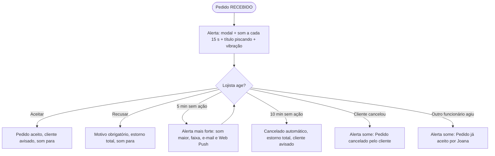

# Telas da Onda 4: transação (sacola, checkout, pedido, painel do lojista)

> Autor: product-designer. Data: 2026-11-18. Histórias: WB-020 a 030, 037 (cliente, app), WB-067 a 072 (lojista, painel web); pagamentos em `prd/pagamentos.md` (WB-151, 152, 154, 158). Base: `design-system.md` (v0.2.0), `identidade.md` §8, `fluxos.md` §2 e §3, `regras-de-negocio.md` RN-04 a RN-08. Itens **[HIPÓTESE]** na §Z.
> Convenções de estado, acessibilidade e testID do app: `onda-3-descoberta-cliente.md` §0. Do painel web: `onda-2-lojista-admin.md` §0. Aqui só o que for diferente.
> Não estão neste arquivo (próxima rodada, 4A web admin): comissões e taxa de serviço (WB-111, 105), estorno e intervenção do admin (WB-109, 108), financeiro. Avaliar e Pedir troca aparecem só como **pontos de entrada** (fluxos completos nas ondas 5).

## 0. Convenções e orçamento

**0.1 Checkout em 3 passos reais:** Sacola (S1) > Checkout em 1 tela (S3) > PIX ou cartão (S5, S4). Barra inferior de navegação **oculta** de S1 a S5 (foco na ação). Ação principal sempre no rodapé fixo, ao alcance do polegar.
**0.2 Estados de pedido (RN-07) e rótulos para o cliente (StatusBadge):**

| Estado | Rótulo | Selo |
|---|---|---|
| AGUARDANDO_PAGAMENTO | "Aguardando pagamento" | alerta + `Clock` |
| RECEBIDO | "Aguardando a loja" | info + `Hourglass` |
| ACEITO | "Pedido aceito" | info + `CheckCircle` |
| EM_SEPARACAO | "Em separação" | info + `Package` |
| SAIU_PARA_ENTREGA | "Saiu para entrega" | info + `Truck` |
| PRONTO_PARA_RETIRADA | "Pronto para retirar" | sucesso + `Storefront` |
| ENTREGUE | "Entregue" | sucesso + `CheckCircle` Fill |
| CANCELADO | "Cancelado" | erro + `XCircle` |
| RECUSADO | "Recusado pela loja" | erro + `XCircle` |
| EXPIRADO | "Pagamento vencido" | neutro + `Clock` |

**0.3 Orçamento de toques e tempo com DEC-012** (campo "Confirmar senha" mantido). Tabela completa em `fluxos.md` §2. Resumo: primeira compra **13 toques, 6 campos, ≈ 93 s no Webag e ≈ 118 s até o PIX confirmado**: dentro da meta de 120 s, **mas com folga de só ≈ 2 s**. A confirmação custa ≈ 7 s; mitigação no desenho: um único olho mostra as duas senhas, colar e gerenciador de senhas liberados (com autopreenchimento o campo some do caminho). Se o Mercado Pago exigir CPF (WB-023 C7), entra mais 1 campo (+8 s) e a meta estoura: ver §Z item 3.
**0.4 Confirmação de e-mail por código (HIP-D07), parecer do Security pendente:** o desenho assume que **não bloqueia** a compra (aguardando parecer, não bloqueante). Banner "Confirme seu e-mail" em S6, S7 e Conta até concluir; confirmação obrigatória para trocar senha, trocar e-mail, exportar dados e excluir conta. **Variante B (se o Security vetar):** a tela do código (S2, vista 3) entra entre "Criar conta" e o checkout: +≈ 45 s, total ≈ 163 s, meta perdida. Controlada por flag (`confirmacao_email_bloqueia_compra`).
**0.5 Pagamento nunca duplica:** botões de pagar ficam inertes após o toque ("Gerando PIX…", "Pagando…"); toque duplo não cria 2 pedidos (idempotência no servidor).

---

# Parte A. App do cliente

## S1. Sacola (WB-020, 021, 022)

**Objetivo:** conferir o que vai comprar e ver o total sem surpresa. **Ação principal:** "Ir para o pagamento".

**Layout (celular, de cima para baixo):**
1. Header "Sacola" com voltar.
2. **Loja:** logo 40, "Casa Bela", "Entrega em 30 a 45 min", link "Ver loja".
3. **Itens** (Linha, divisor entre eles): miniatura 72, nome (2 linhas), "Tam. 42 · Preto" (`caption`), preço `price` à direita, QuantityStepper abaixo (com − em 1 virando lixeira "Remover"; deslizar para remover é só atalho, a lixeira é sempre visível). Aviso do item, quando houver, em Banner inline sob a linha.
4. Link "Adicionar mais itens" (volta à loja).
5. **Cupom:** linha `Tag` "Tem um cupom?" que expande campo + botão secundário "Aplicar". Aplicado: chip "BEMVINDO10 · − R$ 10,00" com "Remover".
6. **PriceSummary:** Subtotal R$ 169,80 · Entrega R$ 5,00 (ou "Grátis"; com endereço aproximado: "a partir de R$ 5,00") · Taxa de serviço R$ 2,00 com `Info` · Cupom − R$ 10,00 · **Total R$ 166,80** (`title1`).
7. **Rodapé fixo:** "Total R$ 166,80" + botão `lg` "Ir para o pagamento".

**Avisos por item (C2, C3):** "Só temos 2 unidades. Ajustamos a quantidade." (alerta) · "O preço mudou de R$ 89,90 para R$ 94,90." (info) · "Esse item esgotou. Remova para continuar." (erro, com botão "Remover"). O total recalcula antes de seguir.
**Taxa de serviço (folha):** "Cobrada pelo Webag em cada pedido para manter o pagamento seguro e o suporte." + "Fechar" **[HIPÓTESE de texto; valor vem da configuração]**.
**Total mínimo (HIP-037):** cupom que zeraria o total mostra no resumo "Valor mínimo cobrado: R$ 1,00."

**O botão do rodapé muda conforme a situação (nunca fica desabilitado sem explicação):**
| Situação | Botão | Complemento |
|---|---|---|
| Normal | "Ir para o pagamento" | n/a |
| Abaixo do mínimo (C5) | "Adicionar mais itens" (vai à loja) | Banner acima: "Faltam R$ 12,00 para o pedido mínimo da loja." |
| Loja fechada ou pausada | "Loja fechada · abre 9h" (inerte, com o motivo no próprio rótulo) | Banner info: "Fechada agora. Abre amanhã às 9h. Sua sacola fica guardada." |
| Item esgotado na sacola | "Ir para o pagamento" (ativo) | Ao tocar: rola até o item e mostra "Remova o item esgotado para continuar." |
| Visitante | "Ir para o pagamento" | Abre S2 (criar conta ou entrar) e volta ao checkout |

**Cupom, mensagens (C2):** "Esse cupom venceu em 10 nov." · "Esse cupom vale a partir de R$ 80,00." · "Esse cupom não existe. Confira o código." · "Esse cupom já foi usado." · "Esse cupom acabou." · "Esse cupom é de outra loja." Aplicado: toast "Cupom aplicado. Você economiza R$ 10,00." (haptic sucesso). Substituir (C3): toast "Cupom trocado. Agora vale CUPOM20." Remover: o total volta ao original.

**Dialog "Esvaziar a sacola?" (WB-021, disparado ao adicionar item de outra loja em D9):** título "Esvaziar a sacola?"; texto "Sua sacola tem 3 itens da Casa Bela. Cada pedido é de uma loja só." Botões empilhados: **"Manter minha sacola"** (primário, 1º; o item novo não entra) e **"Esvaziar e continuar"** (destrutivo, 2º; esvazia e adiciona o novo; toast "Sacola esvaziada. Item adicionado."). Foco inicial no seguro. Sem "Cancelar" extra (o "Manter" é o cancelar).

- **Tablet:** 2 colunas: itens à esquerda; resumo e botão fixos à direita.

| Estado | Comportamento |
|---|---|
| Skeleton | 3 linhas de item e 5 linhas de resumo em skeleton (conferindo estoque e preço) |
| Vazio | EmptyState `Handbag`: "Sua sacola está vazia" / "Escolha produtos de uma loja perto de você." / "Ver lojas". Sacola vencida (7 dias): toast único "Sua sacola ficou parada por 7 dias e foi esvaziada." |
| Erro | EP; falha ao conferir: Banner "Não conseguimos conferir o estoque agora. Você pode tentar de novo no pagamento." e a sacola segue editável |
| Offline | Sacola local editável (ações seguras); banner offline; "Aplicar" cupom: "Conecte-se para aplicar o cupom."; "Ir para o pagamento": "Conecte-se para pagar. Sua sacola está salva." |
| Sucesso | Cupom aplicado (toast); item removido: toast "Camiseta removida." + "Desfazer" |
| Permissão | n/a |

**A11y:** stepper "Quantidade, 2" ajustável; avisos de item com `accessibilityLiveRegion` educada; total lido "Total, 166 reais e 80 centavos". **Android x iOS:** deslizar para remover com a lixeira visível nos dois. **testID:** `cart.store`, `cart.item-<id>`, `cart.item-<id>-qty`, `cart.item-<id>-remove`, `cart.item-<id>-warning`, `cart.add-more`, `cart.coupon-toggle`, `cart.coupon-input`, `cart.coupon-apply`, `cart.coupon-remove`, `cart.coupon-error`, `cart.service-fee-info`, `cart.total`, `cart.submit`, `cart.minimum-banner`, `cart.closed-banner`, `cart.switch-dialog`, `cart.switch-keep`, `cart.switch-clear`. **Analytics:** `cart_viewed`, `cart_store_switch {confirmed}`, `coupon_applied {ok}`.

## S2. Entrar ou criar conta, no checkout (WB-005 C2, WB-006, WB-008; DEC-012)

**Objetivo:** ter conta para pagar, no menor número de campos. **Ação principal:** "Criar conta" (vista 1) ou "Entrar" (vista 2).
> Decisão de design, revisando `fluxos.md` §3: **sem a tela "e-mail primeiro"**. Com DEC-012 (confirmar senha) o orçamento ficou sem folga; a tela de e-mail adicionava 1 toque e ≈ 2 s e ainda confirmava ao visitante se um e-mail tem conta. A tela abre direto em **Criar conta**, com o link "Já tenho conta" para quem volta.
> Esta tela é o ponto de entrada no checkout. As telas completas de login, "esqueci a senha" e código da onda 1B estão em T0-11; a regra de DEC-012 vale em todas (nova senha sempre com confirmação).

**Vista 1: Criar conta (padrão).** Header "Criar conta" com voltar; link "Já tenho conta" no topo. Texto: "Falta pouco para pagar. Sua sacola fica guardada." Campos, nesta ordem: **Nome completo** · **E-mail** · **Celular** (máscara) · **Senha** (medidor) · **Confirmar senha** · caixa "Tenho 18 anos ou mais e aceito os Termos de uso e a Política de Privacidade" (links em tela própria, voltam sem perder o formulário). Um olho controla as duas senhas. Confirmação valida ao sair do campo ou ao igualar o tamanho: "As senhas são iguais." / "As senhas não são iguais." Rodapé: botão `lg` "Criar conta". Se `login_social` estiver ligada (WB-010): acima do formulário, "Continuar com Google" e (iOS, sempre junto) "Continuar com Apple", e o divisor "ou". Desligada: nada aparece.
**Vista 2: Entrar.** Campos E-mail e Senha (olho); link "Esqueci a senha" (o fluxo de recuperação pede código e nova senha com confirmação); botão "Entrar"; link "Criar conta".
**Vista 3: Confirmar e-mail (código).** Mesmo molde de L2 (`onda-2-lojista-admin.md`): 6 caixas, "Reenviar código em 0:30". No desenho padrão é opcional e abre pelo banner "Confirme seu e-mail"; na variante B abre logo após "Criar conta".

**Mensagens:** "Digite seu nome." · "Confira o e-mail." · "Confira o celular com DDD." · "Senha fraca. Use 8 caracteres ou mais, com letras e números." · "As senhas não são iguais." · "Marque a caixa para continuar." · e-mail já existe: "Esse e-mail já tem conta." + botão "Entrar" (mesma mensagem, sem dizer se a conta foi confirmada) · login errado: "E-mail ou senha incorretos." · bloqueio: "Muitas tentativas. Tente em 15 minutos ou redefina a senha." · conta bloqueada: "Conta indisponível. Fale com o suporte." + link.

| Estado | Comportamento |
|---|---|
| Skeleton | n/a (formulário estático); botão em "Criando conta…" ou "Entrando…" |
| Vazio | n/a |
| Erro | Erro de rede: "Não conseguimos criar a conta agora. O que você digitou está aqui." + "Tentar de novo"; senha nunca fica no rascunho |
| Offline | "Conecte-se para criar a conta. O que você digitou está aqui." (botão ativo) |
| Sucesso | Vai direto ao checkout (S3), com a sacola, o endereço e o carrinho preservados; haptic sucesso. Por trás: conta criada e e-mail pendente (banner depois do pedido) |
| Permissão | n/a |

**A11y:** `autocomplete` `name`, `email`, `tel`, `new-password` nas duas senhas (gerenciador preenche as duas); colar permitido; medidor lido "Força da senha: média". **Android x iOS:** botão "Continuar com Apple" em preto ou branco; "Autopreencher senha forte" do iOS preenche a confirmação junto. **testID:** `auth.name-input`, `auth.email-input`, `auth.phone-input`, `auth.password-input`, `auth.password-confirm-input`, `auth.password-toggle`, `auth.terms-checkbox`, `auth.signup-submit`, `auth.go-login`, `auth.login-submit`, `auth.forgot-password`, `auth.google`, `auth.apple`, `auth.otp-input`. **Analytics:** `signup_started`, `signup_completed {method}`, `login_success`.

## S3. Checkout em 1 tela (WB-023, 026)

**Objetivo:** confirmar como recebe e como paga, vendo o total final. **Ação principal:** "Pagar com PIX · R$ 166,80" (ou "Pagar com cartão · R$ 166,80 em 1x").

**Layout (celular, de cima para baixo; blocos agrupados por cartão com fio):**
1. Header "Finalizar pedido" com voltar. Loja: "Casa Bela" em `caption`.
2. **Bloco "Como você quer receber?":** segmentado **Entrega | Retirada** (só as opções que a loja oferece; se só uma, vira título).
   - **Entrega:** ListItem `MapPin` "Rua das Palmeiras, 120 · Jardim Fortaleza" com "Trocar" (abre D3); "Chega em 30 a 45 min". Endereço só aproximado: campos inline **CEP** (autopreenche) e **Número** (+ "Sem número"); link "Adicionar complemento" expande o campo opcional.
   - **Retirada:** endereço da loja, horário de hoje, "Pronto em 20 a 30 min", link "Como chegar" (abre o mapa do aparelho); texto "Você recebe um código de 4 dígitos depois de pagar."
3. **Bloco "Como você quer pagar?":** rádio **PIX** (padrão; "Aprova na hora") e **Cartão de crédito** ("Em até 3x"). Ao escolher cartão, abre o formulário seguro (S4) no próprio bloco. **CPF** (máscara, uma vez, guardado para os próximos): só aparece se o provedor exigir (C7), com a explicação "O Mercado Pago pede o CPF para pagamentos."
4. **Bloco Resumo (PriceSummary):** Subtotal, Entrega (ou "Grátis"), Taxa de serviço, Cupom, **Total**. Idêntico ao que será cobrado.
5. **Rodapé fixo:** botão `lg` "Pagar com PIX · R$ 166,80".

- **Revalidação (RN-05, C5):** ao abrir e ao pagar o app confere preço, estoque, horário e frete. Se algo mudou, abre a folha **"Algo mudou na sua sacola"** com a lista ("Tênis Corrida Veloz: de R$ 89,90 para R$ 94,90", "Camiseta Preta M: esgotou e foi retirada") e novo total; botões "Aceitar e continuar" (primário) e "Voltar à sacola" (secundário). Nada é cobrado sem o cliente ver o valor.
- **Bloqueios, todos com a sacola mantida:** loja fechou: Banner de erro "A loja fechou. Sua sacola está guardada. Abre amanhã às 9h." + "Voltar à sacola" (C4). Fora do raio: só Retirada, ou Banner "Essa loja não entrega nesse endereço." + "Trocar endereço" (C3). Acima de R$ 2.000,00: "O limite por pedido é R$ 2.000,00. Remova itens para continuar." + "Voltar à sacola" (C6).
- **Tablet:** 2 colunas: blocos 1 e 2 à esquerda; resumo e botão fixos à direita.

**Mensagens:** "Digite o número ou marque Sem número." · "Digite o CEP com 8 números." · "Confira o CPF." · "Escolha como quer receber." (se faltar)

| Estado | Comportamento |
|---|---|
| Skeleton | Resumo e total em skeleton; botão inerte com "Conferindo preços…" (≤ 3 s). Blocos 1 e 2 já usáveis |
| Vazio | Sem sacola: volta para S1 vazia (não existe checkout vazio) |
| Erro | Conferência falhou: ErrorState inline no resumo "Não conseguimos conferir os preços." + "Tentar de novo"; criar pagamento falhou: "Não conseguimos gerar o pagamento. Tente de novo." (nada foi cobrado; sem pedido duplicado) |
| Offline | Banner; botão ativo; ao tocar: "Conecte-se para pagar. Sua sacola está salva." |
| Sucesso | Vai a S5 (PIX) ou a S6 (cartão aprovado) |
| Permissão | n/a |

**Botão em carregamento:** "Gerando PIX…" (spinner, largura fixa). Após 6 s: texto "Ainda gerando. Não feche o app." **A11y:** blocos como grupos com título; rádio de pagamento com descrição ("PIX, aprova na hora"); a folha "Algo mudou" prende o foco e devolve ao fechar; o botão fixo não cobre o campo Número (o teclado empurra o conteúdo). **Android x iOS:** `adjustResize` no Android; `KeyboardAvoidingView` e botão "Pronto" no iOS. **testID:** `checkout.mode-delivery`, `checkout.mode-pickup`, `checkout.address`, `checkout.address-change`, `checkout.cep-input`, `checkout.number-input`, `checkout.no-number`, `checkout.complement-toggle`, `checkout.complement-input`, `checkout.pickup-info`, `checkout.pay-pix`, `checkout.pay-card`, `checkout.cpf-input`, `checkout.summary`, `checkout.total`, `checkout.submit`, `checkout.changed-sheet`, `checkout.changed-accept`, `checkout.changed-back`, `checkout.closed-banner`. **Analytics:** `checkout_started`, `payment_method_selected {pix|card}`.

## S4. Cartão de crédito: formulário e resultado (WB-025)

**Objetivo:** pagar com cartão sem expor dados. **Ação principal:** "Pagar com cartão · R$ 166,80 em 1x" (o botão do S3).
- **Formulário (inline no S3):** campos do **provedor** (nunca nos servidores do Webag): Número do cartão (máscara `0000 0000 0000 0000`, ícone da bandeira ao reconhecer) · Validade (`MM/AA`) · Código de segurança (3 ou 4 dígitos, com ajuda "Fica no verso do cartão") · Nome como está no cartão · **Parcelas** (seletor em folha com rádio: "1x de R$ 166,80 sem juros", "2x de R$ 85,10 (total R$ 170,20)", até `parcelas_max` e parcela ≥ R$ 30; sempre o **total final com juros** em destaque). Rótulos sempre visíveis, teclado numérico, `cc-number`, `cc-exp`, `cc-csc`, `cc-name`. Aparência do campo seguro configurada com os tokens (cor, raio, tipografia) **[HIPÓTESE]**: depende do que o SDK/Brick do Mercado Pago permite estilizar.
- **Processando:** botão "Pagando…" e, sem trocar de tela, texto "Estamos confirmando com o banco." Se o banco exigir 3DS (C4): folha de tela cheia "Confirme com seu banco" com o desafio dentro do app e botão "Cancelar"; ao concluir, volta e finaliza.
- **Aprovado:** vai a S6.
- **Recusado (C3):** folha de erro: "O banco não aprovou esse cartão." / motivo amigável ("Saldo insuficiente." · "Confira os dados do cartão." · "O banco recusou a compra.") / "Tente outro cartão ou pague com PIX." Botões: **"Trocar cartão"** (primário) e **"Pagar com PIX"** (secundário). A sacola e os dados do pedido ficam.
- **Em análise:** "Estamos analisando seu pagamento. Avisamos quando o banco responder." O pedido aparece em S8 como "Aguardando pagamento · em análise" (até 30 min **[HIPÓTESE]**).
- **Timeout do provedor (C6):** "Estamos confirmando seu pagamento. Pode levar até 1 minuto. Não feche o app." O app consulta o status; **nunca cobra duas vezes**.
- **Muitas tentativas (C5):** "Muitas tentativas com cartão. Pague com PIX ou tente em 1 hora." (cartão desabilitado, com esse texto como motivo).

**Mensagens:** "Confira o número do cartão." · "Confira a validade." · "Confira o código de segurança." · "Digite o nome como está no cartão." · "Escolha as parcelas."

| Estado | Comportamento |
|---|---|
| Skeleton | Parcelas em skeleton ao calcular; campos seguros carregando com 4 linhas de skeleton (SDK) |
| Vazio | Formulário em branco |
| Erro | Recusa (acima). Falha ao carregar o formulário seguro: "Não conseguimos abrir o formulário do cartão. Pague com PIX ou tente de novo." |
| Offline | "Conecte-se para pagar com cartão. Sua sacola está salva." (os dados digitados permanecem na tela, não são guardados) |
| Sucesso | Aprovado: S6 |
| Permissão | n/a |

**A11y:** erro de cada campo ligado ao campo; resultado lido como alerta; o desafio 3DS é uma tela com título "Confirme com seu banco". **testID:** `card.number-input`, `card.expiry-input`, `card.cvv-input`, `card.name-input`, `card.installments`, `card.installment-<n>`, `card.error-sheet`, `card.change-card`, `card.pay-with-pix`, `card.processing`, `card.3ds-cancel`. **Analytics:** `payment_result {ok, reason}`.

## S5. Pagamento com PIX (WB-024; WB-158)

**Objetivo:** pagar no app do banco e ver a confirmação sozinha. **Ação principal:** "Copiar código".

**Layout (celular, de cima para baixo):**
1. Header "Pague com PIX" (sem voltar direto; ver "Sair").
2. **Valor** `display` "R$ 166,80" + "Casa Bela" em `caption`.
3. **Contagem regressiva** em `numeral` "Vence em 14:32" (ícone `Clock`). Menos de 2 minutos: texto "Falta pouco. Vence em 01:48" em `text.warning` com ícone `Warning` (estado nunca só por cor).
4. **QR Code** 240 (mín. 200) sobre branco com margem 16 (leitura fácil também sob sol).
5. **Botão "Copiar código"** `lg` 56, largura total, primário.
6. **Código copia e cola** truncado em 2 linhas (`caption`, selecionável).
7. **"Como pagar"** em 3 linhas com ícone: `Copy` "Copie o código." · `Bank` "Abra o app do seu banco e escolha PIX Copia e Cola." · `CheckCircle` "Cole e confirme. Esta tela muda sozinha."
8. Texto de ajuda: link "Já paguei" (aparece 60 s depois de copiar **[HIPÓTESE]**) e "Ver meus pedidos".

**Estados do PixPayment:**
| Estado | O que aparece |
|---|---|
| Gerando | Quadrado 240 em skeleton, linhas do código em skeleton, texto "Gerando seu código…"; botão Copiar inerte |
| Aguardando | Layout acima |
| Copiado | Botão vira "Código copiado" com check por 3 s e volta; toast "Código copiado. Abra o app do seu banco e cole."; haptic leve |
| Vence em < 2 min | Contador em alerta com ícone; anúncio ao leitor de tela |
| Vencido | QR e botão são substituídos por `Clock`: "O código venceu." / "Gere outro para pagar." / botão primário "Gerar novo código" (o pedido anterior vira EXPIRADO e o estoque é liberado; se não houver estoque: "Acabou o estoque de Camiseta Preta M. Volte à sacola." + "Voltar à sacola") |
| Pago | Check animado 400 ms (estático com "reduzir movimento"), haptic sucesso, navega a S6 em até 5 s depois da confirmação |
| Falha ao gerar | ErrorState: "Não conseguimos gerar o PIX." / "Nada foi cobrado. Tente de novo." / "Tentar de novo" (sem pedido duplicado) |
| "Já paguei" sem confirmação | Toast "Ainda não recebemos. Pode levar alguns segundos." e nova consulta |

- **Sair (voltar do sistema):** Dialog "Sair do pagamento?" / "Seu PIX continua valendo por 11 min. Você encontra o pedido em Pedidos." / **"Continuar aqui"** (primário) e "Ver meus pedidos". Ao voltar com PIX pendente, o app mostra esta tela com o tempo restante (C5).
- **Tela acesa** enquanto a tela está aberta; ouve a confirmação em tempo real e, voltando do segundo plano, consulta o estado atual.
- **PIX tardio (WB-158):** pago depois de vencer: em S7 aparece "Recebemos seu PIX depois do prazo. O valor volta para você." com o estado do estorno.
- **Tablet:** QR e valor à esquerda, passos e ações à direita.

| Estado da tela | Comportamento |
|---|---|
| Skeleton | Ver "Gerando" |
| Vazio | n/a |
| Erro | Ver "Falha ao gerar"; consulta de status falhou: o contador segue e aparece "Não conseguimos confirmar agora. Tentando de novo." |
| Offline | Banner "Sem conexão. Seu pedido está salvo. Assim que voltar, esta tela confirma o pagamento." O código copiado continua disponível (já está no aparelho); a contagem segue pelo relógio local |
| Sucesso | Ver "Pago" |
| Permissão | n/a |

**A11y:** o contador **não** é lido a cada segundo: anuncia em 5:00, 1:00, 0:30 e ao vencer (região viva educada); o QR tem rótulo "QR Code do PIX. Se preferir, use o botão Copiar código."; o botão Copiar é o primeiro alvo depois do valor. **Android x iOS:** vibração curta no Android e Taptic no iOS ao copiar e ao confirmar. **testID:** `pix.amount`, `pix.countdown`, `pix.qr`, `pix.copy`, `pix.code`, `pix.how-to`, `pix.already-paid`, `pix.view-orders`, `pix.regenerate`, `pix.error-retry`, `pix.leave-dialog`, `pix.leave-stay`, `pix.leave-orders`, `pix.late-refund`. **Analytics:** `pix_generated`, `pix_copied`, `pix_expired`, `payment_confirmed`.

## S6. Pedido confirmado (WB-024 C2, WB-026, WB-190 C1)

**Objetivo:** dar certeza de que deu certo e levar ao acompanhamento. **Ação principal:** "Acompanhar pedido".
- **Layout:** `CheckCircle` Fill 64 em `text.success`; título `title1` "Pagamento confirmado. A loja já recebeu seu pedido!" (único ponto de exclamação permitido); "Pedido #1042" em `numeral`; "Chega em 30 a 45 min" (a faixa da loja, sem prometer horário). **Retirada:** no lugar da previsão, o **código de retirada de 4 dígitos** em `numeral` ("Seu código: 4 8 2 1"), endereço, horário de hoje e "Como chegar". Botão primário `lg` "Acompanhar pedido"; secundário (texto) "Voltar ao início".
- **Aviso de notificações (depois do 1º pedido, WB-190 C1):** Banner no rodapé do conteúdo "Quer ser avisado quando o pedido sair?" com "Ativar avisos" (secundário) e "Agora não". "Ativar avisos" abre o pedido de permissão do sistema. Só 1 banner por vez: o de e-mail ("Confirme seu e-mail") só aparece depois, em S7 e em Conta.

| Estado | Comportamento |
|---|---|
| Skeleton | n/a (vem de S5 com os dados) |
| Vazio | n/a |
| Erro | Se os dados do pedido não carregarem: "Pagamento confirmado. Não conseguimos abrir o pedido agora." + "Ver meus pedidos" (o pagamento nunca fica sem retorno) |
| Offline | O resultado vem do estado local; "Acompanhar pedido" abre o último estado salvo |
| Sucesso | É o estado de sucesso: haptic sucesso, check animado 400 ms (estático com reduzir movimento) |
| Permissão negada | Notificações negadas: a tela não insiste; S7 mostra o banner "Ative os avisos para acompanhar" com "Abrir ajustes" |

**A11y:** foco no título; o código de retirada é lido dígito por dígito. **testID:** `confirmed.title`, `confirmed.order-number`, `confirmed.estimate`, `confirmed.pickup-code`, `confirmed.directions`, `confirmed.track`, `confirmed.home`, `confirmed.push-enable`, `confirmed.push-dismiss`. **Analytics:** `order_placed`, `order_created`.

## S7. Pedido: acompanhar e detalhe (WB-027, 028, 029, 030 C4, 037)

**Objetivo:** saber em que etapa está e falar com a loja. **Ação principal:** depende do estado (tabela). A mesma tela serve para pedido ativo (acompanhar) e encerrado (detalhe).

**Layout (celular, de cima para baixo):**
1. Header "Pedido #1042" com voltar; `Casa Bela` e StatusBadge.
2. **Banners** (1 por vez): e-mail não confirmado, notificações negadas, atualização desatualizada, PIX pendente (com tempo e "Ver QR code").
3. **Linha do tempo** (StatusTimeline, 5 passos): Pedido recebido · Pedido aceito · Em separação · Saiu para entrega (ou Pronto para retirada) · Entregue; cada passo com a hora. Texto contextual sob o passo atual: "A loja tem até 10 min para aceitar. Se não responder, o pedido é cancelado e o valor volta para você." · "Chega em 30 a 45 min."
4. **Ação do estado** (tabela abaixo).
5. **Resumo recolhido:** "3 itens · R$ 166,80 · Ver detalhes" que abre: itens com variação, endereço (ou "Retirada"), forma de pagamento, PriceSummary (valores da época), "Ver comprovante".
6. **Ajuda:** link "Ajuda com este pedido" (leva ao suporte com o número) e, quando cabível, "Não recebi meu pedido".

| Estado do pedido | Ação principal | Outras |
|---|---|---|
| Aguardando pagamento | "Ver QR code" (volta a S5 com o tempo restante) | "Cancelar pedido" (texto; sem custo) |
| Recebido / Aceito | "Falar com a loja" (WhatsApp, mensagem pronta "Olá, sobre o pedido #1042") | "Cancelar pedido" (texto) |
| Em separação | "Falar com a loja" | "Pedir cancelamento" (texto; a loja decide em 10 min) |
| Saiu para entrega | "Falar com a loja" | "Não recebi meu pedido" após 2 h |
| Pronto para retirada | "Como chegar" + código em `numeral` | "Falar com a loja" |
| Entregue | "Avaliar pedido" (ponto de entrada; fluxo na onda 5) | "Pedir troca · até 25 nov" (entrada), "Pedir de novo" (texto), "Não recebi" até 48 h |
| Cancelado, recusado ou expirado | "Ver lojas" | A linha do tempo mostra o último nó em `feedback.danger` com ícone X, o **motivo**, **quem** (loja, você, Webag, sistema) e o **estado do estorno** ("Estorno em processamento" / "Estorno feito em 18 nov") |

**Diálogos:**
| Ação | Texto | Botões |
|---|---|---|
| Cancelar pedido (C1) | "Cancelar o pedido?" / "A loja ainda não começou a separar. Você recebe R$ 166,80 de volta no PIX." (cartão: "...em até 2 faturas") | "Cancelar pedido" (destrutivo) · "Manter pedido" |
| Pedir cancelamento (C2) | "Pedir cancelamento?" / "A loja responde em até 10 minutos." | "Pedir cancelamento" · "Manter pedido". Depois: "Aguardando a resposta da loja" na linha do tempo |
| Não recebi (WB-037) | "Não recebeu o pedido?" / "Vamos avisar a loja e o Webag. O repasse à loja fica retido até resolver." | "Abrir disputa" · "Voltar". Depois: Banner "Disputa aberta · protocolo WB-48213. Respondemos em até 2 dias úteis." **[HIPÓTESE de prazo]** |

- **Comprovante (folha):** número, data e hora, forma de pagamento, valores e ID da transação; botão "Compartilhar".
- **Atraso:** se passar do tempo estimado, Banner de alerta "Seu pedido está demorando mais que o normal." + "Falar com a loja".
- **Tempo real:** atualiza em até 5 s sem ação; cada mudança dá haptic leve e é anunciada ("Pedido aceito"). Sem rede: mantém o último estado com "Atualizado há 3 min".

| Estado da tela | Comportamento |
|---|---|
| Skeleton | Cabeçalho real; linha do tempo com 5 nós em skeleton; resumo em skeleton |
| Vazio | Pedido não encontrado: "Não encontramos esse pedido." / "Ele pode ser de outra conta." / "Ver meus pedidos" |
| Erro | EP; falha numa ação (cancelar): "Não foi possível cancelar agora. Seu pedido continua igual. Tentar de novo." Cancelar duas vezes (toque duplo) gera um só cancelamento |
| Offline | "Sem conexão." + último estado salvo, "Atualizado há 3 min"; ações de escrita: "Conecte-se para cancelar. Seu pedido continua igual." |
| Sucesso | Cancelado: a linha do tempo mostra o estorno iniciado e o toast "Pedido cancelado. O valor volta para você." Disputa aberta: banner |
| Permissão | Notificações negadas: Banner "Ative os avisos para acompanhar." + "Abrir ajustes". WhatsApp indisponível: abre a versão web; sem nenhum, mostra o número com "Copiar número"; loja sem WhatsApp: some o botão e aparece o telefone da loja, se houver |

**A11y:** linha do tempo lida "Passo 2 de 5, Pedido aceito, concluído às 14:32"; mudança de status em região viva educada; código de retirada dígito por dígito. **testID:** `order.status`, `order.timeline`, `order.step-<n>`, `order.hint`, `order.primary-action`, `order.whatsapp`, `order.cancel`, `order.cancel-confirm`, `order.request-cancel`, `order.not-received`, `order.not-received-confirm`, `order.details-toggle`, `order.receipt`, `order.help`, `order.banner-email`, `order.banner-push`, `order.review`, `order.exchange`, `order.reorder`, `order.pickup-code`. **Analytics:** `order_cancelled_by_customer`, `whatsapp_opened`, `order_not_received`.

## S8. Meus pedidos (WB-030)

**Objetivo:** achar um pedido e repetir. **Ação principal:** abrir um pedido (em andamento no topo).
- **Layout:** aba Pedidos da barra inferior (contador com os em andamento). Seção "Em andamento" e "Anteriores" (mais recente primeiro, 20 por página). Linha (72): logo 40, loja, StatusBadge, "18 nov, 14:32 · 3 itens", total à direita. PIX pendente: linha com "PIX pendente · vence em 09:42" e botão texto "Pagar". Pedido entregue: botão texto "Pedir de novo" (Should).
- **Pedir de novo (C3):** adiciona os itens disponíveis; folha "2 de 3 itens estão disponíveis. Faltam: Meia Esportiva (esgotada)." + "Adicionar à sacola" (primário) e "Cancelar". Loja fechada: "Casa Bela está fechada. Abre amanhã às 9h." + "Ver loja".
- **Visitante:** EmptyState `Receipt`: "Entre para ver seus pedidos" / "Seus pedidos ficam guardados na sua conta." / "Entrar" (S2, volta aqui).
- Banner "Confirme seu e-mail" no topo enquanto pendente.

| Estado | Comportamento |
|---|---|
| Skeleton | 5 linhas |
| Vazio | EmptyState `Receipt`: "Você ainda não fez pedidos" / "Quando comprar, o acompanhamento aparece aqui." / "Ver lojas" |
| Erro | EP |
| Offline | Lista do cache + banner |
| Sucesso | Pedir de novo: toast "3 itens na sacola." com "Ver sacola" |
| Permissão | n/a |

**A11y:** cada linha lida com loja, status, data e total. **testID:** `orders.section-active`, `orders.section-past`, `orders.item-<id>`, `orders.pay-pix-<id>`, `orders.reorder-<id>`, `orders.login`, `orders.explore`.

---

# Parte B. Painel do lojista (web)

## P1. Painel de pedidos em tempo real (WB-067, 068, 192)

**Objetivo:** não perder nenhum pedido. **Ação principal:** "Aceitar" (no cartão do pedido novo e no alerta).

**Layout:**
| Breakpoint | Layout |
|---|---|
| Celular | Header do painel (0.6) + **barra de status do painel** (som, conexão) + Tabs "Novos (2)", "Em preparo (1)", "Saiu ou pronto (3)". Lista de cartões de pedido em 1 coluna; no "Novos", botões "Aceitar" e "Recusar" **dentro** do cartão (48, lado a lado) |
| Tablet | Igual, cartões em 1 coluna de até 640 |
| Desktop 1024 a 1279 | Barra lateral + abas, lista larga |
| Desktop ≥ 1280 | **3 colunas** (Novos, Em preparo, Saiu ou pronto), cada uma com título e contagem; número do pedido em `display` e total em `title1`, legíveis a 1 m |

**Cartão de pedido (OrderCard):** número "#1042" · hora "14:32" · **tempo desde que chegou** "há 2 min" (atualiza a cada 30 s; a partir de 5 min em `text.warning` com `Warning`; a partir de 8 min em `text.danger` com `WarningCircle`) · tipo "Entrega" ou "Retirada" (selo com ícone) · "3 itens" + as 2 primeiras linhas ("1x Camiseta Básica M Preto", "2x Meia Esportiva") e "+1" · **total** "R$ 89,90" · selo "Pago". Em "Em preparo" e "Saiu ou pronto", o botão é o **próximo passo** (StatusAction, P2).
**Barra de status do painel:** à esquerda **Som** ("Som ligado" com `SpeakerHigh`, ou "Som desligado" com `SpeakerSlash`) e botão "Tocar som de teste"; à direita **Conexão** ("Sincronizado há 3 s" com `WifiHigh`). Link "Ligar avisos mesmo com a aba fechada" (Web Push, WB-192) quando a permissão está pendente; no iPhone: "No iPhone, adicione o Webag à tela inicial para receber avisos." **[HIPÓTESE, suporte do navegador]**.
**Regra do som (design-system):** ao abrir o painel, faixa no topo "Ligar alertas sonoros" com 1 botão "Ligar som" (o navegador só libera o áudio depois de um toque). Sem isso, faixa **vermelha** persistente: "Alertas sem som. Toque em Ligar som para não perder pedidos." Conexão perdida: faixa vermelha "Sem conexão. Você pode não ver pedidos novos. Reconectando…" com tentativa automática e consulta de reserva por polling. Mantém a tela acesa nesta página (Wake Lock **[HIPÓTESE]**); sem suporte: dica "Deixe a tela ligada para não perder pedidos."

**Alerta de pedido novo (OrderAlert):** celular em **tela cheia** sobre tudo; desktop em modal de 560. Conteúdo: "Pedido novo" (`title1`), total "R$ 89,90" em `numeral`, "3 itens", tipo (Entrega ou Retirada), lista curta dos itens, "Responda em 9:12" (contagem até o cancelamento automático). Botões `lg` 56: **"Aceitar"** (primário) e **"Recusar"** (secundário). Som repete a cada 15 s até a primeira ação; aos 5 min toca mais forte. Título da aba pisca "(1) Pedido novo"; vibração no celular. Vários pedidos: "2 pedidos novos" e um por vez, o mais antigo primeiro. Sem foco preso depois de agir: segue ao próximo ou fecha.
- **Aceitar (1 toque, sem confirmar):** toast "Pedido #1042 aceito." com ação "Imprimir comanda"; o cartão passa a "Em preparo".
- **Recusar:** folha "Por que recusar?" com rádio "Sem estoque", "Loja fechando", "Fora da área", "Problema no pedido", "Outro" (campo de texto obrigatório, até 140). Botão "Recusar pedido" (destrutivo). Resultado: toast "Pedido recusado. O cliente recebe o valor de volta."
- **Conflito (C5):** "Pedido já aceito por Joana." (toast) e o cartão atualiza. **Cliente cancelou (C6):** "Pedido cancelado pelo cliente." e o cartão some; "Aceitar" falharia com "Pedido cancelado".
- **Sem resposta em 10 min:** "Pedido #1042 cancelado por falta de resposta." (aparece no Histórico como "Cancelado · sem resposta").

| Estado | Comportamento |
|---|---|
| Skeleton | 3 cartões por coluna em skeleton, barra de status real |
| Vazio | EmptyState `Receipt` (por coluna ou geral): "Nenhum pedido agora" / "Mantenha esta tela aberta. Avisamos com som quando chegar." / "Tocar som de teste" |
| Erro | EP; faixa vermelha de conexão se for rede |
| Offline | Faixa vermelha de conexão; lista do cache com "Sincronizado há 2 min"; ações: "Conecte-se para aceitar. O pedido continua esperando." (o tempo segue contando) |
| Sucesso | Toasts acima; haptic sucesso no celular |
| Permissão | Funcionário sem a permissão "Pedidos": Sem acesso (EP). Notificações do navegador negadas: faixa discreta "Avisos desligados. Ative nos ajustes do navegador." |

**A11y:** modal do alerta prende o foco, abre com `role="alertdialog"` e anuncia "Pedido novo, 89 reais e 90 centavos, 3 itens"; botões de ação com rótulo completo ("Aceitar pedido 1042"); o som não é o único canal (faixa, título da aba, vibração); contraste dos tempos em alerta com ícone. **testID:** `lojista.orders.sound-status`, `lojista.orders.sound-test`, `lojista.orders.sound-enable`, `lojista.orders.sync-status`, `lojista.orders.connection-banner`, `lojista.orders.tab-new`, `lojista.orders.tab-preparing`, `lojista.orders.tab-ready`, `lojista.orders.card-<id>`, `lojista.orders.card-<id>-accept`, `lojista.orders.card-<id>-reject`, `lojista.orders.card-<id>-next`, `lojista.alert.modal`, `lojista.alert.accept`, `lojista.alert.reject`, `lojista.alert.timer`, `lojista.alert.queue`, `lojista.reject.reason-<id>`, `lojista.reject.text`, `lojista.reject.submit`, `lojista.orders.empty`. **Analytics:** `order_alert_shown`, `order_accepted {seconds}`, `order_rejected {reason}`, `order_timeout`.

## P2. Detalhe do pedido e mudança de status (WB-068, 069, 070, 071)

**Objetivo:** separar, avançar e concluir sem erro. **Ação principal:** o **próximo passo** (StatusAction).
- **Layout:** celular: página com voltar; desktop: painel lateral de 480 sobre a lista (ou página). Cabeçalho: "#1042", StatusBadge, "14:32 · há 18 min". Blocos: **Cliente** (nome "Carla S.", telefone "(11) 91234-5678" com "Falar no WhatsApp"; mascarado "(11) *****-5678" depois do prazo de retenção, RN-14) · **Entrega** (endereço completo e complemento) ou **"RETIRADA"** com o aviso "Peça o código de 4 dígitos ao cliente" · **Itens** (foto 56, nome, variação em destaque "M · Preto", quantidade grande) · **Pagamento** "Pago online (PIX)" · **PriceSummary do lojista** (Venda, Comissão Webag, Tarifa de pagamento, **A receber**) · **Linha do tempo** com ator e hora de cada passo.
- **Próximo passo (StatusAction), um botão `lg` só:** Aceito: "Iniciar separação" · Em separação: "Marcar como saiu para entrega" (ou "Marcar como pronto para retirada") · Saiu: "Marcar como entregue" · Pronto (retirada): "Entregar com código". Pular passos e demais ações no menu "Mais": "Pular para saiu para entrega" (ou "...pronto para retirada") (C1), "Item indisponível" (C: Should), "Entrega não realizada" (C6), "Imprimir comanda". **Não existe voltar status** (só o admin, com auditoria).
- **Entregar com código (retirada, C3):** campo de 4 dígitos (OTP) "Código do cliente"; errado: "Código incorreto. Restam 3 tentativas."; após 5: "Muitas tentativas. Peça ajuda ao Webag." + link do suporte.
- **Marcar como entregue (saiu para entrega):** Dialog rápido "Marcar como entregue?" / "Isso conclui o pedido e inicia o seu repasse." / "Marcar como entregue" · "Cancelar".
- **Entrega não realizada (C6):** folha com motivo obrigatório; aviso "O pedido é cancelado e o cliente recebe o valor de volta. O Webag é avisado." / "Registrar entrega não realizada" (destrutivo).
- **Item indisponível (WB-070, Should):** folha com os itens (caixa + quantidade); abaixo, "Valor que volta para o cliente: R$ 49,90 (já com o cupom proporcional)"; botão "Marcar como indisponível · estornar R$ 49,90". Todos marcados: aviso "O pedido inteiro será cancelado."; não aparece em Saiu ou Pronto.
- **Imprimir comanda (WB-071):** abre a visualização de impressão do navegador; layout para **80 mm** (e A4), preto e branco, sem cor. Conteúdo (de cima para baixo): "WEBAG · PEDIDO #1042" grande, hora, tipo ("ENTREGA" ou "RETIRADA"), nome e telefone do cliente, endereço ou "RETIRADA", linha por item "2x Meia Esportiva · M · Preto", observações, valores, "PAGO ONLINE". Depois do prazo de retenção, endereço e telefone saem mascarados.

| Estado | Comportamento |
|---|---|
| Skeleton | Blocos em skeleton |
| Vazio | Pedido não encontrado: "Não encontramos esse pedido." + "Voltar aos pedidos" |
| Erro | EP; transição negada: "Pedido já aceito por Joana." / "Pedido cancelado." e o painel atualiza |
| Offline | Detalhe em cache; "Conecte-se para mudar o status. Nada foi alterado." |
| Sucesso | Toast "Pedido #1042 em separação." / "Pedido #1042 entregue." |
| Permissão | Sem "Pedidos": Sem acesso. Bloco "A receber" visível só para o dono (RN-13); funcionário vê o pedido sem comissão |

**A11y:** o botão de próximo passo é o último foco antes do menu "Mais"; o OTP segue o padrão do design system; impressão com `@media print`. **testID:** `lojista.order.status`, `lojista.order.customer`, `lojista.order.whatsapp`, `lojista.order.address`, `lojista.order.items`, `lojista.order.summary`, `lojista.order.timeline`, `lojista.order.next`, `lojista.order.more`, `lojista.order.skip-step`, `lojista.order.unavailable`, `lojista.order.not-delivered`, `lojista.order.print`, `lojista.order.pickup-code-input`, `lojista.order.pickup-code-submit`, `lojista.order.delivered-confirm`. **Analytics:** `order_status_changed {status}`.

## P3. Histórico de pedidos (WB-072)

**Objetivo:** consultar pedidos antigos. **Ação principal:** abrir um pedido (a busca é o apoio).
- **Layout:** título "Pedidos"; Tabs "Em andamento" e "Histórico" (Histórico traz Concluídos e Todos). Busca "Número ou nome do cliente"; chips de filtro: período (Hoje, 7 dias, 30 dias, Escolher datas), estado (Entregue, Cancelado, Recusado, Expirado), tipo (Entrega, Retirada). **Celular:** lista de linhas (número, cliente, total, StatusBadge, data); **desktop:** DataTable (Nº, Data, Cliente, Itens, Tipo, Total, Status) com paginação de 20. O detalhe é o P2 em modo leitura (com comissão e avaliação, quando houver).

| Estado | Comportamento |
|---|---|
| Skeleton | 8 linhas |
| Vazio | EmptyState `Receipt`: "Nenhum pedido ainda" / "Os pedidos da sua loja aparecem aqui." / "Ir para o painel de pedidos" |
| Sem resultado | "Nenhum pedido neste filtro." + "Limpar filtros" |
| Erro / Offline | EP |
| Sucesso | n/a (somente leitura) |
| Permissão | Sem "Pedidos": Sem acesso |

**testID:** `lojista.history.search`, `lojista.history.filter-<id>`, `lojista.history.row-<id>`, `lojista.history.page-next`, `lojista.history.empty`.

---

## Z. Hipóteses e pendências desta onda

| # | Item | Tipo | Quem |
|---|---|---|---|
| 1 | Aguarda parecer do Security sobre HIP-D07; desenho assume e-mail pendente sem bloquear a compra. PRD WB-006 C5 e WB-023 C1 ("login confirmado") dizem o contrário: o PO precisa alinhar os critérios à flag `confirmacao_email_bloqueia_compra` | Conflito PRD x desenho | PO, Security |
| 2 | S2 abre direto em Criar conta (sem tela "e-mail primeiro"): revisão de `fluxos.md` §3 por causa de DEC-012. Quem decidiu "e-mail primeiro" foi o design; a mudança poupa 1 toque e evita revelar se um e-mail tem conta | Decisão de design | PO (validar) |
| 3 | CPF no checkout (WB-023 C7): se o Mercado Pago exigir, +1 campo e +8 s: o total vai a ≈ 126 s, acima dos 120 s. Alternativas: pedir CPF só no cartão (PIX do MP costuma dispensar [HIPÓTESE]) ou ligar login Google (poupa ≈ 38 s) | Risco da meta de 2 min | backend-dev confirma exigência; PO |
| 4 | "Pagamento" em cartão depende do que o SDK ou Brick do MP permite estilizar e de como roda em React Native (WebView ou SDK) | HIPÓTESE técnica | mobile-dev, backend-dev |
| 5 | Texto de prazo do suporte ("em até 2 dias úteis") e de em análise do cartão (30 min) | HIPÓTESE, configuráveis | PO |
| 6 | Taxa de serviço: o texto da folha explicativa e o valor vêm da configuração (WB-111) | HIPÓTESE | PO |
| 7 | Web Push no iPhone só com o painel instalado na tela inicial; Wake Lock sem suporte em alguns navegadores | HIPÓTESE, limites do navegador | mobile-dev |
| 8 | Desenho do alerta sonoro: repetição a cada 15 s (PRD), mais forte aos 5 min; cancelamento aos 10 min | Segue PRD (WB-067, 068) | n/a |
| 9 | Painel de pedidos 3 colunas só a partir de 1280 px; em 1024 a 1279 usa abas | Decisão de design (largura dos cartões) | n/a |
| 10 | Telas de comissões e taxa de serviço (4A, web admin), estorno e intervenção do admin e financeiro ficam para a próxima rodada | Fora desta entrega | PM |
