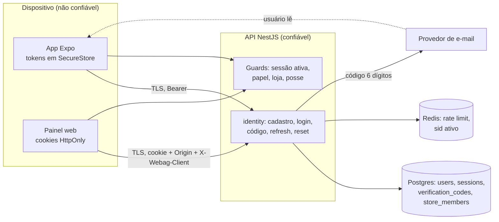
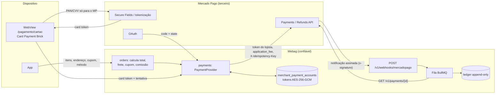

# Threat model — Autenticação/sessão e Pagamentos (Webag 1.0)

- **Autor:** security-engineer | **Data:** 2026-11-18 | **Status:** v1, para G2/G3 das histórias WB-006..010, WB-032, WB-050..053, WB-075, WB-100..102, WB-109, WB-150..160, WB-210..218
- **Base:** brief §3, §4, §6; ADR-002, ADR-003, ADR-004, ADR-005; PRDs `pagamentos.md`, `lgpd.md`, `cliente.md`, `lojista.md`, `admin.md`; `regras-de-negocio.md`; HIP-001..043, HIP-D07, HIP-D10.
- **Requisitos testáveis:** `requisitos-seguranca.md` (SEC-001..099). **Achados nos ADRs/PRDs:** `revisao-adrs.md` (SEC-101+).
- **Fontes:** legenda do ADR-001. **[V]** verificado nesta sessão (tarball oficial `mercadopago@3.6.2` do npm). **[N]** referência não acessível nesta sessão: `www.mercadopago.com.br` e `owasp.org` estão fora da allowlist de rede; conferir antes de implementar. Lista no §10.
- **Escala de severidade (risco inerente, sem o controle):** Crítica = perda direta de dinheiro ou de dados em massa, explorável por qualquer pessoa; Alta = dinheiro/dados de uma vítima ou fraude repetível; Média = exige condição extra ou impacto limitado; Baixa = incômodo ou vazamento mínimo.

## 1. Ativos

| ID | Ativo | Por que importa |
|---|---|---|
| A1 | Dinheiro em trânsito: pagamento PIX/cartão, `application_fee` (comissão), estornos | Perda direta; split 1:1 deixa o dinheiro na conta MP do lojista (ADR-002) |
| A2 | Tokens OAuth do MP de cada lojista (`access_token`, `refresh_token`) | Quem tem o token cria cobrança, estorna e lê dados financeiros da loja |
| A3 | Credenciais da plataforma: `MP_CLIENT_SECRET`, `MP_WEBHOOK_SECRET`, `JWT_ACCESS_SECRET`, `PAYMENT_TOKEN_ENC_KEY`, S3 | Comprometem a plataforma inteira |
| A4 | Sessões: access JWT, refresh token, cookies do painel | Tomada de conta |
| A5 | Contas admin (super, operação, financeiro, suporte) | Estornam, editam lojas, veem documentos |
| A6 | Dados pessoais do cliente: nome, e-mail, celular, endereços, histórico de pedidos, CPF (se exigido), fotos de troca | LGPD, reputação |
| A7 | Documentos do lojista (RG/CNH, comprovante, cartão CNPJ) | Dado pessoal sensível ao contexto de fraude de identidade |
| A8 | Integridade de preço, estoque, cupom e status do pedido | Fraude e prejuízo do lojista |
| A9 | Reputação da loja e da Webag (avaliações, taxa de cancelamento) | Confiança do cliente desconfiado (brief §2) |
| A10 | Disponibilidade do checkout e do webhook | Venda perdida, PIX pago sem pedido |

## 2. Atores

| Ator | Confiança | Capacidade relevante |
|---|---|---|
| Cliente legítimo | Autenticado, não confiável para valores | Controla o app, pode alterar requisições |
| Cliente fraudador | Externo | Multicontas, cupom, "não recebi" falso, chargeback, cartão roubado |
| Lojista dono | Confiável só na própria loja | Configura loja, conecta MP, vê dados do cliente do pedido |
| Lojista mal-intencionado | Interno à loja | Loja falsa, recebe e não entrega, autoconsumo com cupom da Webag, vaza dados de cliente |
| Funcionário de loja | Permissões parciais (RN-13) | Tenta acessar financeiro ou trocar conta de recebimento |
| Admin / insider | Alto privilégio | Estorno indevido, acesso a documentos e PII |
| Atacante externo | Nenhuma | Credential stuffing, enumeração, webhook forjado, IDOR, XSS, SSRF |
| Mercado Pago | Terceiro confiável com validação | Fonte da verdade de pagamento, mas resposta e notificação são validadas (API10) |
| Provedor de e-mail, storage, Sentry, Expo Push | Operadores | Recebem dados; minimizar o que é enviado |

## 3. Fluxos e fronteiras de confiança

### 3.1 Autenticação e sessão

Fronteiras: dispositivo ↔ API (tudo que vem do cliente é hostil); API ↔ e-mail (canal fora do nosso controle, prova posse do e-mail).

### 3.2 Pagamento (PIX, cartão, webhook, estorno, OAuth do lojista)

Fronteiras: app ↔ API (valor nunca confiável); WebView ↔ MP (dado de cartão só aqui); MP → webhook (autenticidade por HMAC, conteúdo confirmado por re-consulta); banco ↔ chave de cifragem (separadas).

## 4. Ameaças (STRIDE) e controles

S Spoofing, T Tampering, R Repudiation, I Information disclosure, D Denial of service, E Elevation of privilege. Dono = quem implementa; QA verifica pelo SEC citado.

### 4.1 Autenticação, sessão e autorização
| ID | STRIDE | Ameaça | Sev. | Controles (requisito) | Dono | Residual |
|---|---|---|---|---|---|---|
| T-01 | S | Credential stuffing e força bruta no login | Alta | Argon2id, senha vazada bloqueada, throttle por conta+IP com step-up por código (SEC-001, SEC-004) | backend-dev | Baixa |
| T-02 | S | Força bruta do código de 6 dígitos (confirmação, reset, exclusão web) | Alta | 5 tentativas, 10 min, uso único, código ligado à finalidade, limite de reenvio (SEC-002, SEC-003) | backend-dev | Baixa |
| T-03 | I | Enumeração de e-mail (tela "e-mail primeiro", cadastro, reset) | Baixa | Rate limit e monitoramento; respostas neutras em reset e exclusão web (SEC-005). A tela "e-mail primeiro" revela existência por desenho | backend-dev, product-designer | Baixa — **risco aceito proposto** (padrão de mercado; CEO valida) |
| T-04 | D | Atacante bloqueia a conta da vítima forçando 5 falhas (HIP-023/WB-008 C3) | Média | Sem bloqueio duro global: limite por conta+IP e step-up por código no e-mail (SEC-004; achado SEC-102) | backend-dev, product-owner | Baixa |
| T-05 | D | E-mail bombing e custo/reputação de envio pelo "Reenviar código" | Média | 60 s, 5/h por conta e finalidade, teto por IP e por destinatário (SEC-003) | backend-dev | Baixa |
| T-06 | S | Pre-hijack: alguém cadastra o e-mail da vítima antes dela; vínculo social com conta não confirmada | Média | Reset por código confirma o e-mail e revoga sessões; login social nunca se liga a conta não confirmada (SEC-008, SEC-009) | backend-dev | Baixa |
| T-07 | S | Roubo de refresh token (aparelho, backup, log) | Alta | Opaco, hash no banco, rotação com detecção de reuso, SecureStore, nunca em log (SEC-011, SEC-012, SEC-072) | backend-dev, mobile-dev | Média (aparelho comprometido está fora do alcance) |
| T-08 | E | JWT forjado (alg `none`, segredo fraco ou de exemplo, troca de `typ`) | Crítica | Algoritmo fixo, `iss/aud/typ` validados, segredo >= 32 bytes checado no boot (SEC-010, SEC-080) | backend-dev | Baixa |
| T-09 | E | Sessão continua válida após logout, troca de senha ou remoção de funcionário (JWT de 15 min, socket aberto) | Média | `sid` checado a cada request e no socket; revogação derruba sockets (SEC-010, SEC-014, SEC-024; achado SEC-101) | backend-dev | Baixa |
| T-10 | T | CSRF nos painéis por cookie | Alta | SameSite=Lax, Origin na allowlist, header customizado obrigatório, CORS exato (SEC-013) | backend-dev | Baixa |
| T-11 | E | XSS armazenado em conteúdo do lojista executa no painel admin (mesma origem, DEC-005) | Alta | Admin em host próprio, CSP, sem HTML de usuário (SEC-082, SEC-083; achado SEC-106) | mobile-dev (web), tech-lead | Média |
| T-12 | S | Sessão roubada troca e-mail/senha e toma a conta de vez | Alta | Reautenticação, código no novo e-mail, aviso ao e-mail antigo, revogação (SEC-007, SEC-016) | backend-dev | Baixa |
| T-13 | E | Phishing de admin ou financeiro | Crítica | TOTP obrigatório para admin, reautenticação em ação de dinheiro, auditoria, teto HIP-039 (SEC-015, SEC-016, SEC-039, SEC-074) | backend-dev | Média |
| T-14 | E | Escalada de papel: cliente se torna lojista/admin por mass assignment; funcionário acessa financeiro ou equipe | Crítica | DTO com whitelist, guard global "deny by default", matriz RN-13 testada (SEC-021, SEC-022) | backend-dev | Baixa |
| T-15 | I | IDOR/BOLA em pedido, endereço, troca, foto, tentativa de pagamento, exportação, extrato | Crítica | Posse checada no service, 404 para recurso alheio, teste de matriz por rota (SEC-020, SEC-024, SEC-025) | backend-dev | Baixa |
| T-16 | I | Lojista vê ou exporta PII além do necessário (e-mail, CPF, histórico após 30 dias) | Média | DTO do lojista sem e-mail/CPF; máscara aplicada no servidor (SEC-023) | backend-dev | Baixa |
| T-17 | S | Convite de funcionário/admin interceptado ou reutilizado | Média | Token 256 bits com hash, uso único, ligado ao e-mail, 48 h para admin (SEC-017) | backend-dev | Baixa |

### 4.2 Pagamentos
| ID | STRIDE | Ameaça | Sev. | Controles (requisito) | Dono | Residual |
|---|---|---|---|---|---|---|
| T-20 | T | App envia preço, frete, desconto, parcelas ou comissão adulterados | Crítica | Servidor recalcula tudo; entrada só aceita IDs e quantidades (SEC-030) | backend-dev | Baixa |
| T-21 | S | Webhook forjado marca pedido como pago | Crítica | HMAC `x-signature` com SDK oficial; `data.id` só da query; re-consulta à API do MP e conferência de valor/loja/referência (SEC-032, SEC-034) | backend-dev | Baixa |
| T-22 | T/R | Replay de notificação, eventos fora de ordem, notificação legada (IPN) sem assinatura | Alta | Tolerância de `ts` de 300 s (no SDK é **opcional e desligada por padrão** [V]), deduplicação por `x-request-id`, máquina de estados idempotente (SEC-032, SEC-033; achado SEC-104) | backend-dev | Baixa |
| T-23 | E | Pedido marcado como pago pelo cliente, por endpoint de dev ou pelo provedor `fake` em produção | Crítica | Não existe endpoint de confirmação pelo cliente; módulo dev não é registrado em produção; boot recusa `fake` em produção (SEC-035, SEC-036) | backend-dev | Baixa |
| T-24 | I | Dado de cartão chega à API, a logs ou ao banco (escopo PCI) | Crítica | Secure Fields do Brick; só token do cartão; varredura de PAN = 0 (SEC-037) | mobile-dev, backend-dev | Baixa |
| T-25 | T | Script de terceiro ou injetado na página de pagamento copia o cartão (skimming) | Alta | Página isolada, CSP restrita, zero scripts de terceiros além do MP (SEC-037; achado SEC-107) | mobile-dev | Baixa |
| T-26 | T | Cobrança ou estorno duplicado (retry em 3G, duplo toque) | Alta | `Idempotency-Key` por usuário + hash do corpo; `X-Idempotency-Key` no MP; único `(provider, provider_payment_id)` (SEC-031) | backend-dev | Baixa |
| T-27 | E/T | Estorno indevido por insider ou admin comprometido; soma de estornos maior que o pago | Alta | Matriz RN-13 + HIP-039, motivo, reautenticação, constraint de soma, só ao meio original, auditoria (SEC-039) | backend-dev | Baixa |
| T-28 | S/E | OAuth CSRF: atacante liga a conta MP dele à loja da vítima e passa a receber as vendas | Crítica | `state` aleatório, uso único, ligado à sessão e à loja; PKCE se suportado; só o dono, com reautenticação (SEC-045; achado SEC-109) | backend-dev | Baixa |
| T-29 | I | Vazamento dos tokens OAuth dos lojistas (dump do banco, backup, log) | Crítica | AES-256-GCM com AAD da loja, chave fora do banco e do backup, nunca em log (SEC-046) | backend-dev | Média (chave e banco no mesmo VPS na 1.0) |
| T-30 | E | Funcionário ou conta do dono comprometida troca a conta de recebimento | Alta | Só dono, reautenticação, e-mail de aviso, auditoria, revisão do admin se o titular divergir (SEC-047, SEC-048) | backend-dev | Baixa |
| T-31 | T | Card testing (validar cartões roubados no nosso checkout) | Média | Teto de recusas por conta/dispositivo, antifraude do MP, limite HIP-012 (SEC-038) | backend-dev | Baixa |
| T-32 | D | MP fora do ar ou webhook perdido: PIX pago sem pedido | Média | Re-consulta por polling de pendentes, conciliação diária, PIX tardio estornado (SEC-040, SEC-042) | backend-dev | Baixa |
| T-33 | I | Guardar dados do pagador (nome, CPF, e-mail do MP) além do necessário | Média | Guardar só IDs, status e valores; CPF só se exigido e cifrado (SEC-044) | backend-dev | Baixa |
| T-34 | T | `application_fee` divergente do cálculo (comissão errada, cupom da plataforma maior que a comissão) | Média | Conferência na re-consulta e na conciliação; teto do cupom no split (SEC-034, SEC-042, SEC-060; achado SEC-105) | backend-dev, product-owner | Média |

### 4.3 Upload, documentos e conta (LGPD)
| ID | STRIDE | Ameaça | Sev. | Controles (requisito) | Dono | Residual |
|---|---|---|---|---|---|---|
| T-40 | T/E | Arquivo malicioso: SVG/HTML com script, poliglota, bomba de descompressão | Alta | Allowlist por magic bytes, re-encode com `sharp` e limite de pixels, SVG proibido (SEC-050) | backend-dev | Baixa |
| T-41 | I | Documento do lojista ou foto de troca exposto (bucket público, URL longa) | Alta | Bucket privado, URL assinada de 5 min após checar permissão, acesso auditado (SEC-051) | backend-dev | Baixa |
| T-42 | T | Sobrescrever objeto de outra loja com chave escolhida pelo cliente | Média | Chave gerada pelo servidor, `complete` confere dono e finalidade (SEC-050) | backend-dev | Baixa |
| T-43 | S/I | SSRF pela "URL da foto" da planilha (WB-065 C6) | Alta | Só HTTPS público, bloqueio de IP interno/metadata após resolver DNS e em cada redirect (SEC-053; achado SEC-111) | backend-dev | Baixa |
| T-44 | T | CSV injection em exportações (extrato, relatórios, linhas com erro) | Média | Neutralizar células que começam com `= + - @` (SEC-052) | backend-dev | Baixa |
| T-45 | I | PDF malicioso explora o leitor do admin | Baixa | Origem separada do painel, sem antivírus na 1.0 (DT-005) (SEC-051) | backend-dev | Baixa — **risco aceito proposto** |
| T-50 | I | Exportação de dados enviada a e-mail errado ou link vazado | Alta | Exige e-mail confirmado + reautenticação; link exige login (SEC-070) | backend-dev | Baixa |
| T-51 | D/R | Exclusão de conta por quem pegou o celular desbloqueado | Média | Reautenticação por senha (SEC-016, SEC-071) | backend-dev, mobile-dev | Baixa |
| T-52 | I | PII, código ou token em log, Sentry ou e-mail não confirmado | Média | Redação de campos, Sentry sem PII, e-mail não confirmado sem dados do pedido (SEC-008, SEC-072, SEC-073) | backend-dev, mobile-dev | Baixa |
| T-53 | R | Ação administrativa sem rastro (estorno, revelar PII, ver documento) | Média | `audit_log` append-only com antes/depois (SEC-074) | backend-dev | Baixa |

## 5. Abuso de regra de negócio (marketplace)

| Abuso | Sinal de detecção | Controle mínimo na 1.0 (requisito) | Depois da 1.0 | Dono |
|---|---|---|---|---|
| **Loja falsa** (golpe com vitrine de eletrônicos baratos) | Preço muito abaixo da média da categoria; titular do MP diferente do CPF/CNPJ; muitos "não recebi" | Aprovação manual com documentos (HIP-030), 1 documento = 1 loja (HIP-031), titular do MP comparado (SEC-047), limites de loja nova (SEC-062) | Score de risco de loja; consulta automatizada de CNPJ | backend-dev, admin (operação) |
| **Lojista recebe e não entrega** (no split o dinheiro já está com ele) | Taxa de "não recebi" > 5%; SAIU_PARA_ENTREGA sem ENTREGUE; reclamação no WhatsApp | Limites de loja nova (SEC-062), código de entrega (SEC-067), suspensão pelo admin. **Webag não retém dinheiro no split** (achado SEC-105) | Retenção de liberação via MP, se o produto do MP permitir `[verificar]` | product-owner, backend-dev |
| **Autoconsumo com cupom da Webag** (lojista compra da própria loja com contas falsas e embolsa o subsídio) | Mesmo dispositivo/telefone/pagador em vários pedidos da mesma loja; concentração de usos | Bloqueio quando cliente coincide com membro da loja; alerta de concentração; subsídio só após ENTREGUE (SEC-060, SEC-061) | Grafo de dispositivos/pagadores | backend-dev |
| **Cupom de primeira compra com multicontas** | Muitas contas por dispositivo/endereço; e-mails descartáveis | Exige e-mail confirmado + 1 por dispositivo, telefone, endereço normalizado e pagador (SEC-060, SEC-063) | Fingerprint de dispositivo do MP | backend-dev |
| **Enumeração de códigos de cupom** | Muitas validações com código inexistente | 10 validações/min por conta, códigos nominais longos e aleatórios (SEC-060) | — | backend-dev |
| **Pedidos falsos contra concorrente** (PIX gerado e não pago trava o estoque da loja, HIP-007) | Muitos AGUARDANDO_PAGAMENTO por conta/dispositivo | Máx. 2 pedidos aguardando pagamento por conta, 5 PIX/hora, loja só é alertada de pedido pago (SEC-064) | — | backend-dev |
| **"Não recebi" falso / friendly fraud / chargeback** | Cliente com reclamações recorrentes; chargeback após ENTREGUE | Código de retirada (HIP-040) e de entrega (SEC-067), histórico de disputas por cliente, mediação com evidência | Bloqueio por score | product-owner, backend-dev |
| **ENTREGUE automático indevido** (HIP-038: 24 h após SAIU) | Lojista marca SAIU em lote | Código de entrega (SEC-067) e alerta de "saiu" sem progressão | — | product-owner |
| **Card testing** | Recusas em sequência | SEC-038 | — | backend-dev |
| **Avaliação falsa** | Muitas notas 5 de contas novas | Só pedido ENTREGUE do próprio cliente, 1 por pedido (SEC-065) | Moderação por padrão | backend-dev |
| **Scraping de catálogo** | Volume alto por IP sem sessão | Rate limit de listagem e paginação máxima (SEC-066) | — | backend-dev |
| **PIX tardio ou duplicado** | Pagamento aprovado em pedido EXPIRADO/CANCELADO | Estorno automático idempotente (SEC-040) | — | backend-dev |

Observação de rede: no Brasil o celular costuma sair por CGNAT (muitos usuários no mesmo IP). Limites só por IP derrubam clientes legítimos; os requisitos combinam conta, dispositivo e IP com tetos mais altos para IP.

## 6. Parecer sobre HIP-D07 (confirmação de e-mail depois do primeiro pedido)

**Parecer: APROVADO COM CONDIÇÕES.** Não bloquear a primeira compra pela confirmação do e-mail.

**Por quê.** O código por e-mail não protege o dinheiro da primeira compra. No PIX, o dinheiro sai da conta do próprio pagador. No cartão, o risco é de cartão roubado, que o e-mail confirmado não reduz; quem reduz é o antifraude/3DS do MP e os limites do SEC-038. O que a confirmação protege é: recuperação de conta, canal de comunicação, abuso de incentivo (cupom) e envio de dados por e-mail. Tudo isso pode ser exigido **depois**, nos pontos em que importa. O custo de exigir antes é alto e está medido: ≈ +45 s, que estoura a meta de 2 min (`fluxos.md` §2).

**Condições (todas testáveis em SEC-008):**
1. No máximo **1 pedido pago** com e-mail não confirmado; o checkout seguinte pede o código (tela WB-007). Configurável.
2. Sem e-mail confirmado ficam bloqueados: cupom da plataforma e de primeira compra, exportar dados, trocar e-mail, ativar papel de lojista (já em WB-050 C4) e aceitar convite de equipe.
3. **Exclusão de conta não exige o código**, só reautenticação por senha. *Diverge do texto de HIP-D07*: se o e-mail foi digitado errado, o código nunca chega e o usuário ficaria preso, contrariando Apple 5.1.1(v) e LGPD art. 18, VI.
4. Enquanto não confirmado, o e-mail enviado contém **só o código e texto genérico**: sem nome completo, endereço, itens ou valores. Recibo e detalhes ficam no app e no push. Evita mandar dado pessoal para a caixa de outra pessoa (LGPD art. 46).
5. Campo de e-mail com sugestão de domínio (`gmial.com` → `gmail.com`) e, na tela do pedido, "Confirme seu e-mail: nome@... · Corrigir". Corrigir um e-mail ainda não confirmado invalida o código anterior.
6. Anti pre-hijack: o reset por código confirma o e-mail e **revoga todas as sessões**; login social só se liga a conta com e-mail confirmado (SEC-009).
7. Rate limit de cadastro (SEC-063) e de pedidos aguardando pagamento (SEC-064) ativos antes de ligar a flag.
8. Métrica: % de contas não confirmadas após 7 dias. Acima de 20% indica e-mail digitado errado ou contas falsas e reabre a decisão.

**Risco residual:** Baixo. Há um caso que não fecha: um e-mail digitado errado que existe e cujo dono faz "esqueci a senha" passa a ver o histórico desse cliente. A condição 5 reduz a chance; aceito como Baixo.
**Alavanca recomendada:** ligar "Entrar com Google/Apple" no lançamento (`fluxos.md` §2 alavanca 1). O provedor devolve `email_verified`, o que dispensa o código e economiza ≈ 29 s. Depende das credenciais do fundador.

## 7. O Mercado Pago exige CPF no PIX e no cartão?

| Meio | Resposta | Fonte |
|---|---|---|
| PIX (Payments API) | **Não é campo obrigatório no contrato da API.** No SDK oficial, `payer.identification` é opcional; o obrigatório documentado para PIX é `payer.email`. O banco do pagador identifica quem paga no momento do PIX. Na API Pix do BCB, o `devedor` da cobrança também é opcional | [V] `mercadopago@3.6.2` `dist/clients/payment/create/types.d.ts` (`identification?: Identification`); [N] doc PIX do Checkout Transparente; [N] API Pix BCB (`devedor` opcional) |
| Cartão (Card Payment Brick) | **O formulário do Brick no Brasil pede o documento do titular (CPF/CNPJ)**, dentro do próprio formulário do MP. A Webag não cria campo de CPF; o documento volta no `formData` do Brick e segue para `POST /v1/payments` | [N] doc do Card Payment Brick (MLB) |

**Recomendação:** manter HIP-D10. Não pedir CPF no PIX; no cartão, deixar o Brick coletar. O CPF que passa pela API vai para o MP e **não é persistido** (SEC-044). **Verificar no sandbox** antes do G4 (teste em SEC-044): (a) PIX sem `identification` é aprovado; (b) a taxa de aprovação do cartão não cai sem dados extras do pagador. Se o MP recusar ou exigir o documento, pedir o CPF no checkout com finalidade "pagamento", cifrado (WB-023 C7).

## 8. LGPD aplicada a estes fluxos

| Tema | Posição | Validar com |
|---|---|---|
| Base legal | Conta, pedido e pagamento: execução de contrato (art. 7, V). Documentos do lojista: prevenção a fraude/legítimo interesse (art. 7, IX) ou obrigação legal | jurídico |
| Exportação (art. 18, II e V; art. 19) | Automática, ≤ 24 h, prazo legal de 15 dias atendido (HIP-025); exige e-mail confirmado (SEC-070) | — |
| Exclusão (art. 16 e 18, VI) | Imediata e sem código (§6 condição 3); retém o fiscal (art. 16, I). Guardar HMAC de e-mail/telefone só para impedir o reuso de cupom de primeira compra é **pseudonimização, não anonimização** e precisa de base e de prazo próprios | jurídico, antes de ligar |
| Encarregado (art. 41) | A Res. CD/ANPD nº 2/2022 dispensa o agente de pequeno porte de indicar encarregado, mas exige canal com o titular. Recomendo indicar o fundador mesmo assim (custo zero; WB-217) | jurídico |
| Incidente (art. 48) | Res. CD/ANPD nº 15/2024: comunicar ANPD e titulares em 3 dias úteis (prazo em dobro para pequeno porte). Procedimento do security antes do G4 | security-engineer |
| Logs de acesso | 6 meses (Marco Civil, art. 15), sem senha, código ou token (SEC-075) | — |

Não sou advogado: as bases legais, o uso do hash anti-abuso e o enquadramento como pequeno porte precisam de parecer profissional antes da publicação (G5).

## 9. Risco residual e decisão

- **Nenhuma ameaça fica Crítica ou Alta depois dos controles.** Ficam **Médias**: T-07 (aparelho comprometido), T-11 (XSS lojista → admin, até o host separado), T-13 (phishing de admin com TOTP), T-29 (chave de cifragem no mesmo VPS) e T-34/abuso "recebe e não entrega" (split sem retenção, achado SEC-105).
- **Decisão:** design **aprovado para implementação**, com duas condições antes de codar WB-151..154: resolver SEC-104 e SEC-105 (`revisao-adrs.md`). O G4 fica bloqueado até passarem todos os requisitos marcados **G4 = Sim** em `requisitos-seguranca.md`.
- **Fora do alcance deste trabalho:** não há código de auth/pagamento ainda (só o esqueleto da API). Este é um modelo de design, não teste. Antes de escalar (HIP-043, ou mais de ~1.000 pedidos/mês), contratar pentest externo de API + app. A documentação do MP não pôde ser lida nesta sessão (domínio bloqueado): todo [N] de pagamento é confirmado no sandbox.

## 10. Fontes
- [V] `mercadopago@3.6.2` (npm, 2026-11-18): `dist/utils/webhook/index.js`. Manifesto `id:{data.id};request-id:{x-request-id};ts:{ts};`, HMAC-SHA256 em hex, comparação em tempo constante. `toleranceSeconds` opcional ("Omit to skip the check"). `dataId` = parâmetro `data.id` da **query string**. Notificações de QR Code **não são assinadas**. Partes ausentes são omitidas do manifesto. `dist/clients/payment/create/types.d.ts`: `payer.identification` opcional.
- [N] Mercado Pago: webhooks https://www.mercadopago.com.br/developers/pt/docs/your-integrations/notifications/webhooks ; OAuth https://www.mercadopago.com.br/developers/pt/docs/security/oauth ; Card Payment Brick https://www.mercadopago.com.br/developers/pt/docs/checkout-bricks/card-payment-brick/introduction ; Payments API https://www.mercadopago.com.br/developers/pt/reference/payments/_payments/post
- [N] BCB, API Pix (cobrança imediata, `devedor` opcional): https://bacen.github.io/pix-api/
- [N] OWASP API Security Top 10 2023: https://owasp.org/API-Security/editions/2023/en/0x11-t10/
- [N] OWASP ASVS 5.0.0 (2025), capítulos V2 (lógica de negócio), V4 (API), V5 (arquivos), V6 (autenticação), V7 (sessão), V8 (autorização), V9 (tokens), V10 (OAuth), V11 (cripto), V14 (proteção de dados), V16 (logs): https://owasp.org/www-project-application-security-verification-standard/ — nível alvo: **L2** em auth e pagamento, L1 no restante
- [N] OWASP MASVS v2.1 (STORAGE, CRYPTO, AUTH, NETWORK, PLATFORM, CODE, RESILIENCE, PRIVACY): https://mas.owasp.org/MASVS/
- [N] OWASP Cheat Sheets: Authentication, Forgot Password, Session Management, CSRF Prevention, File Upload, SSRF Prevention, Password Storage — https://cheatsheetseries.owasp.org/ ; CSV Injection — https://owasp.org/www-community/attacks/CSV_Injection
- [N] RFC 9700 (OAuth 2.0 Security BCP), RFC 7636 (PKCE), RFC 8725 (JWT BCP) — https://www.rfc-editor.org/
- [N] Sudhodanan, A.; Paverd, A. "Pre-hijacked accounts", USENIX Security 2022
- [N] PCI DSS v4.0.1, SAQ A (formulário de pagamento terceirizado): https://www.pcisecuritystandards.org/document_library/
- [N] LGPD (Lei 13.709/2018), arts. 7, 16, 18, 19, 37, 41, 46, 48: https://www.planalto.gov.br/ccivil_03/_ato2015-2018/2018/lei/l13709.htm ; Res. CD/ANPD nº 2/2022 e nº 15/2024: https://www.gov.br/anpd/ ; Marco Civil (Lei 12.965/2014), art. 15
- [N] Apple App Store Review Guidelines 4.8 e 5.1.1(v): https://developer.apple.com/app-store/review/guidelines/ ; Google Play, exclusão de conta: https://support.google.com/googleplay/android-developer/answer/13327111
